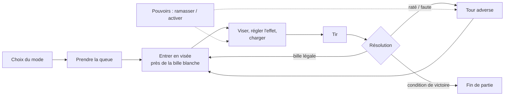

# Game Design Document

> Document vivant, construit à partir de la TODO (état au 02/10/2026). Chaque partie distingue ce qui est **✅ implémenté**, **🔄 en cours** et **📌 décidé mais pas commencé**. Tout ce qui n'est pas encore tranché est dans [Pistes & suggestions](gdd.html#pistes).

## 1. Concept

**UntitledPoolGame** est un **jeu de billard loufoque** où le billard n'est qu'un **prétexte** : un prétexte pour vivre des moments de jeu drôles entre amis, façon party game. On joue en vue à la première personne, on se balade dans la salle, on prend une queue… et chaque décor détourne la partie avec son propre twist : horreur dans une prison hantée, billes en apesanteur dans une base spatiale, sabotages, coups et ragdolls.

**Références** : *What the Golf?* (le sport détourné à chaque niveau), *Super Battle Golf* (le sport en chaos entre amis), *Mario Tennis* / *Mario Golf* (un sport accessible rendu spectaculaire par des coups et pouvoirs spéciaux). **Points forts** : le **friend slop** et le **couch coop** (à deux sur le même canapé, en écran partagé), l'aspect **WTF** et drôle.

### Piliers

1. **Le billard comme prétexte** — des règles connues de tous (8-ball, 9-ball, 14.1) : chacun comprend l'objectif avant que tout déraille.
2. **Rire entre amis** — couch coop, sabotages, objets lancés, coups, ragdolls : le plaisir vient autant des coups tordus et des réactions de l'autre que des beaux coups.
3. **Chaque décor, son twist** — un décor change l'ambiance **et** les règles du jeu, jusqu'à des modes très éloignés du billard classique.
4. **Le WTF assumé** — surprises, absurde, situations qu'on raconte après la soirée.
5. **La liberté FPS** — on marche autour de la table, on ramasse, on lance ; le billard se joue avec le corps du personnage.

### Fiche

| | |
|---|---|
| Genre | Party game / billard physique, vue FPS |
| Joueurs | 2 — écran partagé local ✅ · en ligne 📌 |
| Moteur | Unity 6 (6000.6), URP |
| Contrôles | Clavier/souris et manette |

## 2. Boucle de jeu

### Une partie

1. **Choix du mode** dans le menu d'avant-partie (8-ball, 9-ball, 14.1, Party), où l'on choisit en visant et en tirant les billes. ✅ (menu 2D 🔄)
2. Le joueur **prend une queue** : n'importe laquelle, à n'importe quel moment (les queues n'appartiennent à personne ; seul le tir est réservé au joueur dont c'est le tour). ✅
3. Près de la bille blanche arrêtée, il **entre en visée** : le personnage se place derrière la queue, la caméra tourne autour de la bille. ✅
4. Il **règle l'angle et le point de frappe** (effet), **charge** la puissance puis relâche. ✅
5. **Résolution** selon les règles du mode : le tour continue, passe à l'adversaire, ou une faute donne la **main libre**. ✅
6. En mode Party, les **pouvoirs** ramassés sur la table s'activent à tout moment pour gêner l'adversaire ou améliorer son tir. ✅

### Boucle méta 📌

Voyager d'une **dimension** à l'autre, chacune avec sa salle, ses règles et ses pouvoirs. Le système de dimensions et le framework de règles par dimension sont décidés mais pas commencés.

## 3. Contrôles

Le récapitulatif complet des touches clavier / manette, général et selon la situation, est dans **[Contrôles](gdd.html#controles)**.

En bref : ZQSD + souris (sticks) pour bouger et regarder, **E / Y** pour interagir, **clic gauche / X** pour le tir, le lancer et le coup de queue, **clic gauche / RB** pour le poing (mains vides), **clic droit / RT** pour le pied, **Q / B (○)** pour le pouvoir.

## 4. Le joueur

- **Déplacement FPS** maison : le corps tourne avec la caméra, pas de saut. ✅
- **Personnage visible** avec animations de marche / strafe / rotation. ✅ Course, visée, emotes : 📌
- **Ramasser et lancer** n'importe quel objet prévu pour, **avec les mains** : la main va chercher l'objet (on se penche s'il est bas), un objet léger se tient dans la main droite et part d'un geste du bras, un objet lourd se porte à deux mains et se lance au-dessus de la tête. Maintenir Attaque charge, relâcher lance. 🔄 (en pause, derniers réglages à tester)
- **La queue** se ramasse en tendant les bras vers elle, quelle que soit sa position (au sol, debout, en biais) ; en visée, le corps se place derrière elle et se penche au-dessus de la table pour les coups lointains, la tête suit la bille, la queue glisse dans les mains pendant la charge. ✅
- **Ragdoll** : un coup ou un objet lancé fait tomber le joueur (PuppetMaster), puis il se relève ; la caméra recule à la 3ᵉ personne pendant la chute puis revient dans les yeux pendant le relevé. Le ragdoll ne reste plus coincé au sol ni derrière un mur. ✅

## 5. Le billard

### Physique ✅

Frottement de roulement et de glissement calculés par bille, rebonds vifs sur les bandes, feutre amorti. Effets réels : coulé (topspin), rétro (backspin), effet latéral, obtenus en décalant le point de frappe sur la bille blanche.

### Visée ✅

- Caméra en orbite autour de la bille blanche, rapprochée pendant la charge.
- Ligne de trajectoire jusqu'au premier contact, et direction prise par la bille touchée (pas de rebonds sur bande).
- Le personnage se colle à la table : seul son corps doit rester hors de la table, la queue passe au-dessus de la bande. ✅
- Bille lointaine : **coup allongé** (hanche sur la bande, jambe arrière levée, la visée tremble un peu). Au-delà, le tir est bloqué avec un message : il faut contourner la table (la main avant lâche alors la queue). ✅
- Prévu : coup **derrière le dos** quand la ligne longe la bande côté joueur. 📌

### Règles communes ✅

- **Main libre** après une faute : vue de dessus, le joueur déplace la bille blanche (en évitant les poches) puis valide.
- **Tours** : stricts en écran partagé ; seul, un joueur peut jouer les deux côtés (hot-seat).

## 6. Modes de jeu

| Mode | Règles (version décontractée) | État |
|---|---|---|
| **8-ball** | Groupes pleines / rayées attribués à la première bille empochée. **Faute** : toucher d'abord une bille hors de son groupe, rentrer la blanche, ou ne rentrer **que** des billes de l'adversaire (avec une des siennes, le coup est bon et le joueur garde la main). Annonce de poche **uniquement pour la 8** : le joueur vise la poche avec le pointeur blanc (même choix que les pouvoirs qui visent un trou) et valide avec Interact. Empocher la 8 trop tôt, dans la mauvaise poche ou avec la blanche = défaite. | ✅ |
| **9-ball** | Billes 1 à 9 seulement. Toucher d'abord la plus petite bille. Empocher la 9 gagne (sauf avec la blanche = défaite). | ✅ |
| **14.1 continu** | 1 point par bille empochée légalement, premier au score cible. Pas de re-rack. | ✅ |
| **Party — Classique** | 8-ball + pouvoirs. Premier sous-mode Party : d'autres pourront s'ajouter au sous-menu. | ✅ |
| **Speed Pool** | Pas de tour : les deux joueurs tirent **en même temps**, chacun avec sa blanche (bleue J1, rouge J2). J1 a les pleines, J2 les rayées, sans la 8. Le premier qui a vidé son groupe gagne (rentrer une bille de l'autre l'aide). Blanche rentrée : elle revient à son point de départ au bout de 5 s, et la dernière bille de ton groupe que tu avais rentrée ressort. Aucune autre faute (rentrer une bille de l'autre l'aide déjà, et le jeu le fait remarquer à celui qui l'a rentrée). Nombre de billes par joueur réglable. **Avec ou sans pouvoirs** (option du menu) : avec, seulement les caisses ; une Attaque touche l'adversaire tout de suite et dure jusqu'à la fin de son prochain tir. | 🔄 prototype |
| **Catch the Hole** | Un ou plusieurs **trous apparaissent sur le tapis**, en plus des six poches (qui ne bougent pas). Une bille qui passe dessus tombe. Le trou est vivant : il **grandit et rétrécit** au hasard, et **se déplace au hasard mais de façon fluide**. Il peut rester en place un moment, puis repartir. Il peut **accélérer** au fil de la partie, ou avec un minuteur. **Les pouvoirs donnent la main aux joueurs sur tout ça** : la taille, la vitesse, le déplacement et l'arrêt du trou. À cadrer : nombre de trous et moment où ils apparaissent, sort d'une bille tombée (revient à sa place comme avec le Trou, ou compte comme empochée), ce qui fait accélérer (le déroulé de la partie ou un minuteur), liste des pouvoirs. | 📌 à cadrer |
| **Play Anywhere** | Un genre de **golf dans le décor** : la bille se joue dans toute la salle, et plus seulement sur la table. À cadrer : but (trou, cible, parcours), surfaces jouables, visée et tir hors de la table. | 📌 à cadrer |

D'autres modes aux objectifs propres sont envisagés (voir *Pistes & suggestions*).

## 7. Pouvoirs

### Règles ✅

- **Mode Party uniquement.**
- **Deux pouvoirs en stock par joueur** 🔄 : la molette (D-pad gauche / droite à la manette) choisit celui que le bouton de pouvoir lance ; le HUD montre le sélectionné en grand, l'autre en petit. Ramasser un pouvoir qu'on a déjà le fait passer au **niveau 2** (« NIVEAU 2 ! ») ; déjà au niveau 2, ou avec deux pouvoirs différents en stock, le pouvoir ramassé est perdu (« Déjà plein ! »). Après un lancer, l'autre pouvoir est sélectionné.
- **Deux sources** : des **caisses** qui apparaissent sur la table à des emplacements aléatoires et réapparaissent après ramassage (chacune est une forme 3D qui représente son pouvoir, sur un anneau à la couleur de sa catégorie, et qui tourne et flotte 🔄), et une **bille à pouvoir** (lumineuse, change régulièrement) qu'il faut empocher.
- **Trois catégories**, chacune avec sa couleur, son matériau et son modèle de caisse : **Attaque**, **Défense**, **Effet**.
- **Activation** avec le bouton de pouvoir. **Quand** on peut le lancer se règle pour chaque pouvoir : réservé à son propre tour (Effets), ou utilisable pendant le tour adverse (Attaques). Une attaque lancée pendant le tour adverse prend effet **immédiatement** ; lancée pendant son propre tour, elle attend le début du tour adverse, ou elle est refusée si le pouvoir le demande. Un pouvoir peut aussi être interdit pendant que les billes roulent.
- **Retour à l'envoi** ✅ : le lanceur voit « Envoyé ! » (ou « Activé ! »), l'adversaire reçoit une carte « J1 T'ENVOIE … » qui dit si ça frappe tout de suite ou au début de son tour, et chacun a son moment Feel. Un appui au mauvais moment fait trembler la pastille du pouvoir avec la raison. Le personnage **pointe** la cible pendant le choix et **lève le pouce** une fois le pouvoir envoyé, pour que l'adversaire le voie aussi dans la salle.
- **Niveaux** 🔄 : un pouvoir a un niveau (1 ou 2, version renforcée), atteint en ramassant le même pouvoir une deuxième fois ; un badge « N2 » le montre dans le HUD. Seul le Trou a pour l'instant un vrai niveau 2 (un groupe de trous) ; les autres restent identiques au niveau 2, en attendant que leur version renforcée soit décidée.
- **Pouvoirs qui visent la table** ✅ (Trou) : même choix que pour une poche, mais le pointeur vise un point du tapis, avec un cercle d'aperçu de la zone touchée.
- **Pouvoirs qui visent un trou** : le bouton de pouvoir ouvre d'abord un **choix du trou**. Un pointeur blanc au centre de la vue désigne le trou, qui est entouré d'un cercle. Interact valide, le bouton de pouvoir annule. Le personnage **pointe du doigt** l'endroit visé pendant le choix, puis **lève le pouce** une fois le pouvoir envoyé ✅.

### Pouvoirs implémentés ✅

| Pouvoir | Catégorie | Effet | Durée |
|---|---|---|---|
| **Tir boosté** | Effet | Le prochain tir est plus puissant | Prochain tir |
| **Vision brouillée** | Attaque | L'écran de l'adversaire blanchit et sa visée devient moins sensible | Tour de l'adversaire |
| **Commandes inversées** | Attaque | Regard inversé, sensibilité augmentée, ligne de trajectoire masquée | Tour de l'adversaire |
| **Poche fermée** | Attaque | La poche choisie par le joueur est bouchée | Tour de l'adversaire |
| **Bille destructrice** | Effet | La première bille touchée explose et compte comme empochée. Une mauvaise bille explose aussi, mais c'est une faute et elle est perdue au profit de l'adversaire ; la 8 est épargnée | Prochain tir |
| **Aimant** | Effet | La bille du joueur qui roule vers le trou choisi est captée et tirée dedans (la plus proche si plusieurs, une seule par tir). La 8 n'est attirée que vers la poche annoncée | Prochain tir |
| **Groupe identique** | Attaque | Toutes les billes sauf la blanche prennent le même aspect (incolore, ou celui d'une bille choisie dans les réglages), la 8 comprise ; la plaque des billes restantes est masquée. Les règles ne changent pas | Tour de l'adversaire |
| **Trou** ✅ | Attaque | Le joueur vise un point de la table. Lancé pendant son tour, l'endroit est marqué et la boule de feu tombe au début du tour de l'adversaire (pendant le tour adverse, en écran partagé : tout de suite). Elle s'écrase et creuse un trou, avec une secousse et une vibration des manettes pour les deux joueurs. Une bille qui passe dessus tombe et revient à sa place d'avant le tir à la fin du coup ; la blanche, elle, est une faute. Niveau 2 : un groupe de trous répartis au hasard autour du point visé, parfois au milieu | Réglable : tour de l'adversaire, prochain tir, toute la partie ou N tours |

Aucun pouvoir de **Défense** n'existe encore. Une vingtaine d'idées de pouvoirs attendent d'être choisies (voir *Pistes & suggestions*).

## 8. Dimensions et environnements 📌

- **Système de dimensions** : chargement et transition entre « salles » de billard.
- **Règles configurables par dimension**, décrites dans des fichiers de configuration (ScriptableObjects), comme les réglages existants (physique, effets, pouvoirs).
- Contenu prévu, pour valider le système :
  1. une **première dimension jouable** (salle + règles de base) ;
  2. une **deuxième dimension aux règles loufoques** ;
  3. une dimension **« shooter miniature »** : le joueur est réduit sur la table, la queue devient une arme et les billes des ennemis.
- **Chaque décor a son twist** (idées, à définir) :

  | Décor | Ambiance | Twist de gameplay |
  |---|---|---|
  | **Le bar** (décor de base) | Bar de quartier le soir, néons | Le billard « classique » : pouvoirs, objets du bar à lancer, bagarres, ragdolls |
  | **La prison hantée** | Cellules, néons qui grésillent, brouillard | La partie **bascule dans l'horreur** : lumières qui s'éteignent pendant un tir, **jump scares**, billes qui bougent seules ; un **Némésis** traque le joueur pour l'empêcher de jouer (géré par le jeu ou **incarné par l'autre joueur**, à trancher) |
  | **La base spatiale** | Station orbitale, alarmes | **Billes en apesanteur**, gravité qui change, sas qui aspire billes et joueurs |
  | **Shooter miniature** | Le joueur rétréci sur la table | La queue devient une arme, les billes des ennemis |
- La caméra de visée devra s'adapter à ces changements d'échelle et de vue.
- **Salles et ambiances** 🔄 : les salles se construisent avec le **Level Maker** (outil d'éditeur : murs, portes, sols, étages, kits de décor interchangeables). Une même salle peut recevoir **plusieurs ambiances** (lumières, post-process, brouillard), chacune avec son éclairage précalculé, et en changer en cours de partie : c'est la base visuelle des dimensions. Détail dans [Outil de niveau](outils.html#level-maker).

## 9. Combat et PNJ

- **Coup de queue** ✅, **« armer en tournant »** : queue en main et hors visée, **maintenir Attaque** charge le coup, **relâcher** frappe. La **direction** vient de la rotation faite pendant la charge : tourner à droite arme la queue à droite (le coup balaie vers la gauche), et inversement ; lever la tête = coup vertical ; sans rotation = estoc de la pointe, en position de tir. On voit pendant la charge le coup qui va partir. À la frappe, la vue revient vers là où l'on regardait à l'appui, ou vers l'adversaire proche (assistance légère), pour que le coup tombe sur la cible. Un coup léger fait tituber, un coup chargé fait **tomber en ragdoll** (chute garantie à pleine charge). Possible à tout moment, dans tous les modes.
- **Mains nues** 🔄 (code écrit, à tester) : **poing** (mains vides) et **pied** (à tout moment). Esprit **Gang Beasts** : les poings partent en crochet dès le clic et s'enchaînent en spammant, en alternant les mains ; ils font tituber (pas de poing chargé). Le pied : clic bref = coup de pied, appui maintenu = coup chargé ; le **pied chargé est un coup de pied spartiate** façon *300* : la cible est projetée loin en arrière, avec un zoom sur la vue de l'attaquant.
- **Jauge d'encaissement** 🔄 (R&D : testé sur le joueur de R&D, pas encore sur le joueur normal) : les coups reçus remplissent une jauge ; tant qu'elle n'est pas pleine, le joueur titube seulement ; au-delà de 60 %, il est **sonné** (plus lent, il dérive, la vue tangue) ; pleine, il est **K.O.** : il tombe en ragdoll et reste quelques secondes au sol. À son **réveil**, la jauge est vide et un court répit évite les K.O. en boucle. Elle redescend avec le temps. Pour l'instant, seuls les poings et les pieds la remplissent.
- **Garde** 🔄 (R&D : testé sur le joueur de R&D, pas encore sur le joueur normal) : maintenir **Ctrl gauche / LT**.
  - **Ce qu'elle bloque** : les coups de face, à la tête et au corps, qui ne comptent presque plus. Le pied passe à moitié.
  - **En garde** : on avance plus lentement et on ne peut pas frapper.
  - **Garde brisée** : trop de coups encaissés, ou un coup de pied spartiate, et la garde se brise. Le spartiate brise alors la garde sans mettre K.O. Le joueur ne peut plus garder pendant un moment, et les coups comptent de nouveau normalement.
  - **Endurance** : chaque coup coûte de l'endurance. Fatigué, on frappe plus lentement et plus faiblement. Vide, on ne peut plus frapper le temps de récupérer. Ça évite le spam.
  - **Contre-attaque** : relâcher la garde juste après avoir bloqué permet une contre-attaque plus rapide et plus forte.
- **Coups localisés** 🔄 (R&D : testé sur le joueur de R&D, pas encore sur le joueur normal) : un coup à la tête compte plus qu'un coup au corps, et un coup aux jambes moins. Chaque coup reçu se voit : le personnage réagit du côté d'où vient le coup, plus fort à la tête. Sonné, il vacille. Au K.O., sa chute dépend du dernier coup : il s'écroule en arrière (tête), se plie (corps) ou ses jambes se dérobent.
- **Place du combat pendant une partie** 📌 à cadrer : dans quels modes, effet d'un coup sur le joueur qui vise, lien avec les pouvoirs (pistes dans la TODO).
- **PNJ** de base (déplacement, détection du joueur) et **combat FPS** contre eux.

## 10. Multijoueur

- **Écran partagé local, 2 joueurs** : chaque joueur rejoint en appuyant sur un bouton de son appareil, avec sa propre caméra et ses propres contrôles. ✅ Deux manettes : une manette libre fait arriver J2, même quand J1 joue au clavier ; seul, le joueur reprend le clavier dès qu'on s'en sert. 🔄 (changé le 21/10, à tester)
- **En ligne** 📌 : Netcode for GameObjects. La couche réseau viendra se poser sur les scripts du mode local, avec un serveur qui fait autorité sur la physique des billes. Transport envisagé : Unity Relay + Lobby.

## 11. Game feel 🔄

Déjà en place, à calibrer en jeu : secousse et zoom pendant la charge, recul et flash au tir, halo et aura sur la poche quand une bille tombe, secousse sur faute et au ramassage d'un pouvoir, léger ralenti à l'empochage.

## 12. Interface actuelle

Le **menu d'avant-partie** suit la direction retenue, en version 2D (🔄, à tester) : titre, joueurs, choix du mode, dans le décor du bar ; on vise une bille avec la queue et on tire pour choisir. Typo des menus : **Titan One**. L'**UI en jeu** suit la même direction (✅ validée le 05/10). Chaque joueur a sa partie d'écran :
- une plaque à sa couleur, avec les billes qui lui restent ;
- « À toi ! » chez celui qui joue, l'autre moitié assombrie ;
- le pouvoir en stock ;
- la jauge de puissance et le point de frappe ;
- les messages d'aide.

Les temps forts ont leur interjection (« FAUTE ! », « Dans le mille ! », « OHHH ! »). Un pouvoir ramassé arrive comme un sponsor. La fin de partie montre la carte du gagnant avec « Revanche ». À venir : replay en incrustation, ardoise et trophées de fin.

### Parcours des menus 🔄 (intégré, à tester)

Proposé le 05/10 dans le prototype [Parcours des menus](ui/parcours.html), intégré dans Unity le 08/10 avec les variantes retenues (menu sur la table, pause en carte). Le menu a sa propre scène. Choisir un niveau le charge derrière un **écran de chargement** (variante « Le retour des billes » : carte postale du niveau, billes qui tombent dans la gouttière, astuces, puis chaque joueur appuie sur A). Les textes, les astuces et les images des niveaux sont modifiables sans toucher au code. Les sauvegardes, l'histoire, les niveaux prison et station et le jeu en ligne restent à venir.

- **Menu principal** :
  - **Nouvelle partie** : histoire, avec tutoriel au début (à venir) ;
  - **Charger une partie** : emplacements de sauvegarde ;
  - **Just for fun** : une partie tout de suite, choix du niveau puis du type de partie (Classique, Pouvoirs, 9-ball, 14.1, Speed Pool) ;
  - **Multijoueur** : local (écran partagé, J2 rejoint) ou en ligne (héberger / rejoindre avec un code), puis niveau et type de partie ;
  - **Réglages** : pour l'instant les touches (clavier / souris et manette, réaffectables) ;
  - **Quitter**.
- **En jeu** : Échap / Start ouvre la pause. Elle propose Reprendre, Réglages et Menu principal (avec confirmation), et arrête les deux joueurs en écran partagé.
- Variantes retenues : menu principal sur la table (billes), pause en carte.

### Mini-jeu : la borne d'arcade 📌 (aperçu jouable)

Dans le bar, une borne d'arcade fait tourner **SUPER POOL SHOT**, un vrai billard d'arcade à niveaux façon console 8 bits, sur un vieil écran cathodique ([aperçu jouable](ui/arcade.html)).
- **Le jeu** : physique réelle et effet sur la blanche. 7 niveaux à coups limités, dont 2 coups de maître. Combos, vies, CONTINUE?, et un mode 2 joueurs en alterné.
- **La blague** : un code secret façon années 80 sur l'écran titre fait filer toutes les billes dans les poches.
- **Usage** : un moment pour souffler entre deux parties, ou pour faire patienter l'autre joueur.

### Direction retenue 📌

Validée le 29/09/2026 sur le prototype [Synthèse](ui/synthese.html) (page **[Propositions UI](ui.html)**) :

- **Style « billard pop »** : cartes crème à contour sombre et ombre pleine, couleurs de joueur (J1 bleu, J2 rouge), jaune pour ce qui est commun, typo épaisse (Bowlby One pour les titres, Titan One pour les menus, choisie le 01/10).
- **Menus** (titre, joueurs, mode) : la table de billard posée dans le bar, éclairée par sa lampe ; on choisit en **visant une bille et en tirant**.
- **En partie** : l'UI se superpose directement à l'image du jeu — une plaque par joueur (couleur, billes restantes), « À toi ! » chez celui qui joue, pouvoir en stock en haut à droite, jauge de puissance segmentée qui tremble au maximum ; **interjections** sur les événements (« FAUTE ! », « Dans le mille ! »), **replay** en incrustation façon petit écran TV, **pouvoirs présentés comme des sponsors** (« Ce tour vous est offert par… »).
- **Fin de partie** : sur l'image du jeu floutée, vainqueur en bandeau, **ardoise de la partie** en tableau face à face (une barre par statistique) et **trophées** de chaque joueur.
