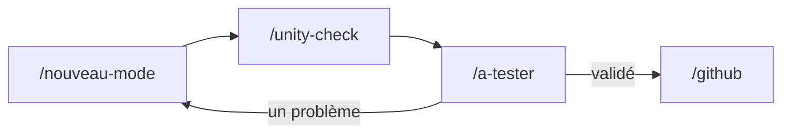

# Skills de Claude

> Les skills sont des recettes propres au projet, rangées dans `.claude/skills/`. Claude Code les charge dans ce dépôt : on tape `/nom-du-skill`, ou on demande simplement la chose en français, et Claude suit la recette. Les demandes et les réponses ci-dessous sont des exemples, sauf le résultat de `/unity-check`, qui est réel.

## En un coup d'œil

| Skill | Quand s'en servir | Exemple de demande |
|---|---|---|
| [`/unity-check`](#unity-check) | Vérifier que le code compile, sans ouvrir Unity | « Est-ce que ça compile ? » |
| [`/nouveau-mode`](#nouveau-mode) | Ajouter, renommer ou retirer un mode de jeu | « Ajoute un mode Curling Pool » |
| [`/nouveau-pouvoir`](#nouveau-pouvoir) | Ajouter, renommer ou retirer un pouvoir | « Ajoute un pouvoir qui gèle une poche » |
| [`/a-tester`](#a-tester) | Préparer une session de test, puis traiter le retour | « Qu'est-ce que je teste ce soir ? » |
| [`/github`](#github) | Branche, commit, Pull Request, merge | « Prépare un commit » |
| [`/refacto`](#refacto) | Auditer ou réorganiser le code sans changer le jeu | « Fais un audit de `PoolMatchRules` » |
| `/notion-todo` | Tenir la base Notion à jour avec la TODO | « Démarre la tâche Curling Pool » |

Une fonctionnalité passe en général par cette chaîne :



## unity-check

**Pour savoir si les scripts compilent, sans ouvrir Unity.** Claude le lance de lui-même après avoir modifié du code. Il faut seulement que le projet ait été ouvert une fois dans Unity sur ce poste.

> « Est-ce que ça compile ? » ou `/unity-check`

Quand tout va bien :

```text
OK  Assembly-CSharp : 0 erreur, 75 avertissement(s)
OK  Assembly-CSharp-Editor : 0 erreur, 0 avertissement(s)
Duree : 5 s. Compile ne veut pas dire teste : Unity seul peut lancer le jeu.
```

Quand une erreur est trouvée, le résultat donne le fichier et la ligne, et Claude corrige puis relance.

**À retenir :** « compilé » ne veut pas dire « testé ». Le skill ne voit ni une référence cassée dans une scène, ni une erreur pendant le jeu.

## nouveau-mode

**Pour ne rien oublier en ajoutant un mode.** Un mode touche une dizaine de fichiers, et le compilateur ne signale presque aucun oubli.

> « Ajoute un mode Curling Pool : chacun son tour, la bille la plus proche du centre marque, pas de pouvoirs. »

Claude pose les questions qui changent le jeu : le mode est-il sur la roue de Boogie Night ? Tour par tour, Speed Pool, ou les deux ? Puis il déroule la liste :

- les règles, les réglages et le HUD ;
- la ligne du menu et la roue, **y compris dans les fichiers de données** : `Mode.asset` et `BoogieNightSettings.asset` gardent leurs anciennes valeurs, donc sans eux le mode n'apparaît pas ;
- le GDD, les réglages et la doc technique, la TODO et le changelog.

Il compare ensuite avec un mode récent pour repérer un oubli, et termine par ce qu'il reste à faire dans Unity :

> Compilé, non testé. Dans Unity : *Tools > Pool > Ensure Config Assets Exist*, puis *Lancer sans le menu* avec *Mode* = *CurlingPool*.

Il sert aussi à retirer un mode : « Retire le mode Curling Pool du menu et de la roue. »

## nouveau-pouvoir

**La même chose pour un pouvoir.** Il couvre la classe, le fichier de réglages, le jeton 3D, l'icône du HUD et la doc.

> « Ajoute un pouvoir Poche gelée pour Speed Pool : une poche refuse les billes pendant 10 s, 20 s au niveau 2. »

Claude demande la catégorie et s'il peut être lancé hors de son tour, puis code le pouvoir. Il termine par les deux outils à lancer, et par le test le plus court :

> 1. *Tools > Pool > Ensure Config Assets Exist*
> 2. *Tools > Pool > Générer les jetons de pouvoir*
> 3. En jeu, **C + X** : se donner le pouvoir au niveau 1 puis 2, à J1 puis J2. Vérifier qu'il ne sort que dans Speed Pool.

## a-tester

**Pour faire baisser la pile de « compilé, non testé » sans y passer la soirée.** Il choisit 5 à 7 points dans la TODO, regroupés pour éviter de changer de scène.

> « Qu'est-ce que je teste ce soir ? J'ai 30 minutes. » ou `/a-tester bowling`

```text
Mise en place : scène de test, Lancer sans le menu, Mode = BowlingPool
1. Faire un strike → le score affiche X et la frame suivante commence
2. Tirer pendant que les quilles tombent → le tir est refusé
3. Envoyer une quille dans une poche → elle compte
Logs lus après coup : [Bowling]
```

Après le test, inutile de copier la console :

> « C'est bon pour 1 et 3, mais au 2 la queue passe à travers la table. » ou `/a-tester retour`

Claude lit le journal d'Unity, cherche les exceptions, puis met à jour la TODO et Notion. **Seul un humain valide :** des logs propres restent un indice, jamais une validation.

## github

**Pour tout le parcours Git, avec un accord à chaque étape.** Demander un commit ne vaut pas accord pour pousser, et une PR ouverte ne vaut pas accord pour merger.

| Demande | Ce qui se passe |
|---|---|
| « Où en est le dépôt ? » (`/github etat`) | Trie les fichiers modifiés : à ne jamais committer, bruit d'Unity, à confirmer, à ranger par tâche. |
| « Crée une branche pour Curling Pool » (`/github branche`) | Crée `feature/curling-pool` depuis `master` à jour. |
| « Récupère les nouveautés de master » (`/github sync`) | Intègre `master` et s'arrête sur tout conflit de scène ou de prefab. |
| « Prépare un commit » (`/github commit`) | Relit le diff, vérifie que ça compile, met la doc à jour, dit ce que la passe a changé, puis propose le message. |
| « Ouvre la PR » (`/github pr`) | Pousse la branche et écrit un titre et des puces lisibles sur Discord. |
| « Merge la PR 42 » (`/github merge`) | Vérifie la PR, rappelle ce qui n'a pas été testé, attend l'accord, merge sans squash. |

Un exemple de tri :

```text
== JAMAIS (BarSplitscreen, LeartesStudios, csproj) : 1
  1 Assets/Scenes/BarSplitscreen.unity

== BRUIT (.meta de .unitypackage sans leur paquet, scenes de secours Unity) : 59

== A TRIER PAR TACHE : 8
  8 .claude/skills/...
```

## refacto

**Pour réorganiser le code sans changer le jeu.** Pour nettoyer seulement ses dernières modifications, `/simplify` suffit.

Commencer par un audit, qui ne modifie rien :

> « Fais un audit de `PoolMatchRules`. » ou `/refacto audit PoolMatchRules`

| Cible | Problème mesuré | Gain | Risque | Testé en jeu ? |
|---|---|---|---|---|
| `Tick` de `PoolMatchRules` | Un `else if` par mode | Un fichier de moins à toucher par mode | Faible | Non : à tester d'abord |

Puis choisir une ligne :

> « OK pour le `Tick`. » ou `/refacto Tick de PoolMatchRules`

Le projet n'ayant pas de tests automatisés, le skill suit des règles strictes :
- **Il s'arrête si le code visé n'a jamais été testé en jeu**, sauf si on le lui demande explicitement. Sinon, impossible de distinguer un ancien bug d'une régression.
- **Une refacto par PR**, en petites étapes : d'abord déplacer, ensuite simplifier.
- **Il vérifie ce que le compilateur ne voit pas** : valeurs d'Inspector, références dans les scènes, ordre d'initialisation en écran partagé.
- **Il finit par une liste de tests ciblés**, et la PR attend ces tests avant le merge.
