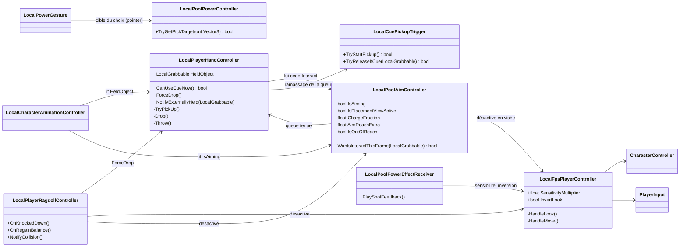
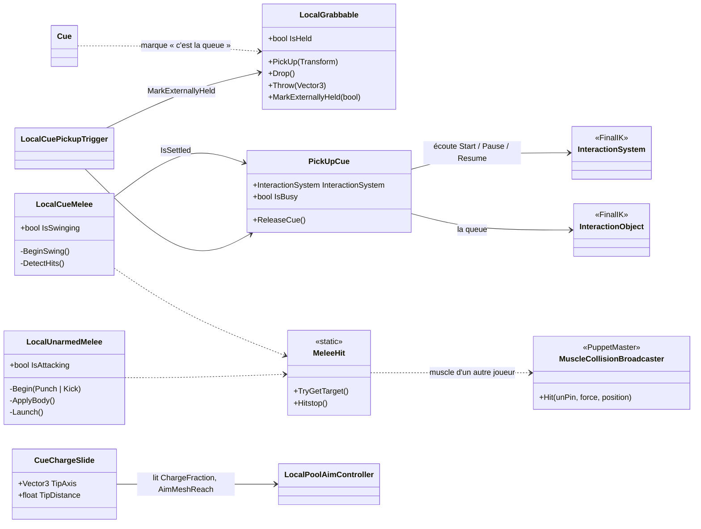
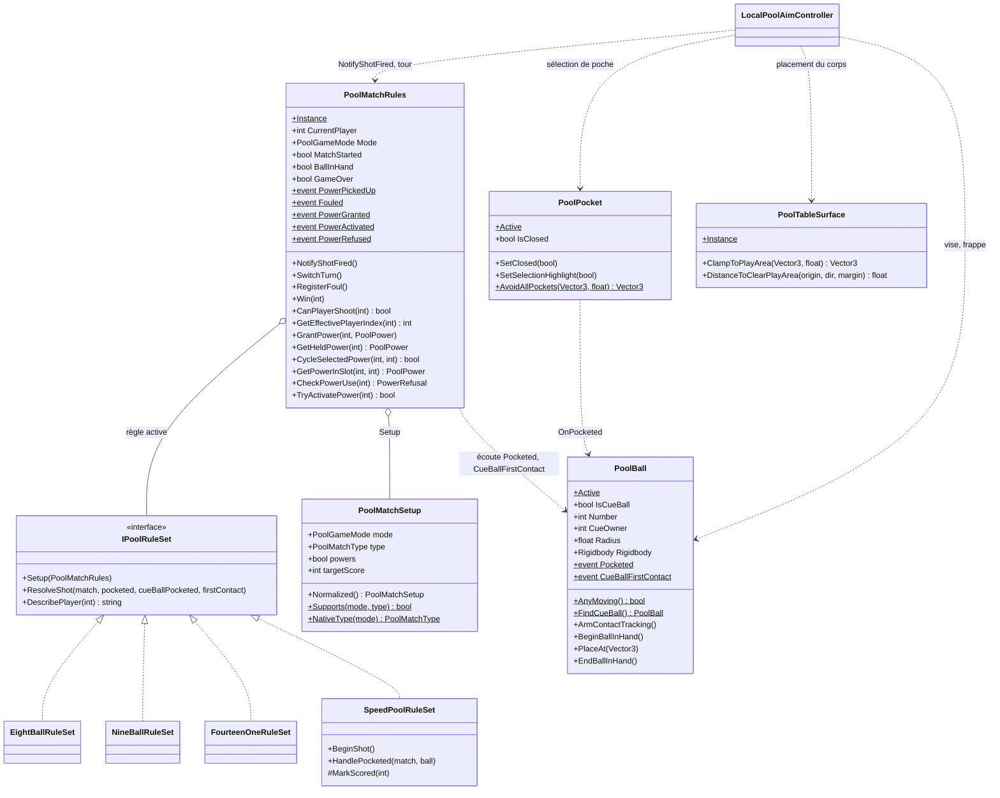
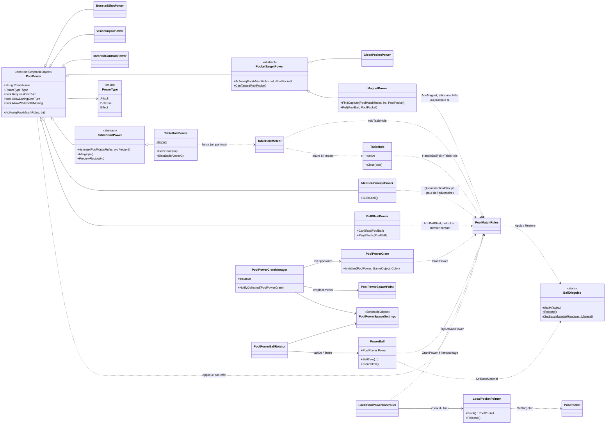

# Architecture et diagrammes de classes

> État du code au 29/09/2026 (`Assets/Scripts`). Seuls les scripts `Local*` sont maintenus ; les scripts online (`FpsPlayerController`, `PlayerHandController`, `Grabbable`, `PoolAimController`, `CharacterAnimationController`, `PoolPowerController`) sont conservés mais figés et n'apparaissent pas ici.

## Vue d'ensemble

Le code est découpé en quatre espaces de noms (namespaces) :

| Namespace | Rôle | Scripts principaux |
|---|---|---|
| `UntitledPoolGame.Player` | Déplacement, caméra, animation, ragdoll du joueur | `LocalFpsPlayerController`, `LocalCharacterAnimationController`, `LocalPlayerRagdollController`, `RagdollHitRelay`, `LocalCharacterModelFollow` |
| `UntitledPoolGame.Interaction` | Ramasser, porter, lancer ; la queue ; les coups (queue, poing, pied) | `LocalPlayerHandController`, `LocalGrabbable`, `Cue`, `LocalCuePickupTrigger`, `PickUpCue`, `CueChargeSlide`, `LocalCueMelee`, `LocalUnarmedMelee`, `MeleeHit` |
| `UntitledPoolGame.Pool` | Billard : billes, table, règles, visée, pouvoirs, réglages | `PoolBall`, `PoolPocket`, `PoolTableSurface`, `PoolMatchRules`, `IPoolRuleSet` et ses règles, `LocalPoolAimController`, `PoolPower` et ses pouvoirs, config ScriptableObjects |
| `UntitledPoolGame.Core` | Outils transverses et triches de test | `PhysicsLayerSetup`, `SplitScreenCheatSpawner`, `PlayerDeviceRouter`, `EightBallEndgameCheat`, `DebugMenu` (menu de test en jeu, passe par les `PoolMatchRules.Debug*`), `RagdollDummySpawner`, `ScenePlayerSpawner`, `NetworkBootstrap` |

Un outil d'éditeur, `PoolTableBuilder` (namespace `UntitledPoolGame.PoolEditor`), génère la table, les billes, les poches, les queues et les points d'apparition des pouvoirs. Le **Level Maker** (`LevelMakerWindow`, même namespace, Tools > Pool > Level Maker) monte un niveau jouable par étapes en s'appuyant dessus (`AttachPhysicsTo`, `AddPowerSpawnSystemTo`) et vérifie la scène (`LevelValidator`) ; voir la page [Level Maker](outils.html#level-maker).

### Principes

- **Un composant = une responsabilité** : le joueur est un assemblage de composants (`LocalFpsPlayerController` pour bouger, `LocalPlayerHandController` pour tenir, `LocalPoolAimController` pour viser…) qui se désactivent entre eux selon l'état (visée, ragdoll).
- **Singletons de scène** pour ce qui est unique : `PoolMatchRules.Instance`, `PoolTableSurface.Instance`, `PoolPowerCrateManager.Instance`.
- **Registres statiques** plutôt que des recherches coûteuses : `PoolBall.Active`, `PoolPocket.Active`.
- **Événements statiques** pour découpler : `PoolBall.Pocketed`, `PoolBall.CueBallFirstContact`, `PoolMatchRules.Fouled`, `PoolMatchRules.PowerGranted`, `PoolMatchRules.PowerActivated` / `PowerRefused`.
  - **Sens d'une bille rentrée** : `PoolMatchRules.MeaningOfPot` (Good, Opponent, EarlyEight) est lu par `MatchHud` et `GameFeel` sur `PoolBall.Pocketed`. Seule une bille du joueur est fêtée. Les règles, elles, jugent le tir entier à sa fin (`IPoolRuleSet.ResolveShot`).
- **Données dans des ScriptableObjects** : réglages (physique, effets, pouvoirs) et chaque pouvoir est un asset (voir *Configuration → rendu*).
- **Stratégie pour les règles** : `PoolMatchRules` délègue la résolution d'un tir à une implémentation de `IPoolRuleSet` choisie au lancement de la partie.

## Joueur

**Gestes des pouvoirs** : `LocalPowerGesture` (ajouté par `LocalPlayerHandController`) pointe la cible pendant le choix d'un trou ou d'un point (`LocalPoolPowerController.TryGetPickTarget`) et lève le pouce après `PoolMatchRules.PowerActivated`. Avant que FBBIK résolve (`OnPreUpdate`), il place l'effecteur d'une main : bras tendu vers la cible, ou main devant la poitrine. Il s'abonne en dernier, à chaque nouveau geste, pour passer après la prise de la queue. Après la résolution (`OnPostUpdate`), il tourne la main et plie les doigts avec `HandPose`, le même outil que le poing de `LocalUnarmedMelee`. Réglages : `PoolPowerSpawnSettings` (*Geste*).

**R&D déplacement** (branche `feature/deplacements-combat`) : `LocalPlayerLocomotion`, présent seulement sur la variante `New_PlayerVariant`, prend le déplacement à `LocalFpsPlayerController`, qui ne garde alors que le regard.
- **Mouvement** : élan, sprint, saut, escalade des rebords (détection par rayons : mur devant, dessus plat à bonne hauteur, place pour se tenir debout), avec les paramètres d'animation `Jump` et `JumpLeg`.
- **Corps mou** : il règle les `props.muscleWeight` / `pinWeight` des muscles PuppetMaster des bras, des mains et du buste quand les mains sont libres, et revient aux valeurs d'origine sinon. Il ajoute aussi un décalage du bassin FBBIK (`bodyEffector.positionOffset`) contre l'accélération, et pose les mains sur le rebord pendant l'escalade.
- **Vue** : décalage et roulis du pivot de caméra, ajoutés en `LateUpdate` puis retirés. Réglages : `MovementSettings`.

Tous ces composants sont sur la racine du prefab joueur. `PlayerInput` (Input System) fournit à chacun les actions de **ce** joueur : c'est ce qui permet deux joueurs sur le même PC.

## Queue et objets tenus

- Les objets ordinaires passent par `LocalObjectHands` (ajouté automatiquement au joueur) : la main droite va chercher l'objet, un objet léger est attaché à la main droite et lancé par-dessus l'épaule, un objet lourd est tenu à deux mains et lancé depuis au-dessus de la tête ; l'objet quitte la main en cours de geste (`LocalGrabbable.ReleaseFromHand`). Composant désactivé : ancien chemin `LocalGrabbable.PickUp/Drop/Throw` (objet collé devant le joueur).
- **Nouvelle prise procédurale (en test)** : `LocalCueHolder`, sur le joueur, prend la main sur la queue tant qu'il est présent et actif (le décocher = retour à l'ancienne prise ci-dessous, intacte). Les queues n'ont pas de propriétaire : chaque `Cue` s'inscrit dans `Cue.All` tant qu'elle est active (placée dans le niveau ou apparue en cours de partie) et expose ce qu'il faut pour la prendre (objet ramassable, glissement, prises des deux mains). On peut ramasser à tout moment, seul le tir dépend du tour. Il cherche la queue libre à portée que le joueur regarde, calcule deux prises autour du point de la queue le plus proche d'un point confortable devant la poitrine (main droite à droite), oriente les mains à partir des cibles de port de la queue (ses `InteractionTarget`), plie les genoux (pieds épinglés, effecteur du corps abaissé), puis amène la queue en pose de port (`PickUpCue.HoldPoint` / `CarryRotation`) en faisant glisser les mains jusqu'aux prises de port. `LocalPlayerHandController.CueBusy` / `CueSettled` exposent l'état de la prise, quel que soit le système. `FrontHandRelease` (0 → 1) fait lâcher la queue à la main avant (côté pointe). `LocalPoolAimController` s'en sert quand la bille est hors de portée : le corps se redresse, puis la main reprend la queue dès que le coup redevient possible.
- **Portée en visée** (`LocalPoolAimController`) :
  - Le corps se place sur la ligne de tir, juste hors de la table (*Table Clearance Margin* depuis le bord du tapis).
  - La distance restante est couverte successivement par les bras (*Max Hand Stretch*), le buste penché (*Max Body Lean*), la queue qui glisse dans les mains, puis le coup allongé (*Max Stretch Reach*).
  - Dans le coup allongé, le bassin monte sur la bande, le buste se couche, le pied d'appui est tenu par l'IK et l'autre jambe se lève. Le bassin est retenu au bord du tapis, gardé au-dessus de la table, et l'écart est compensé par la flexion du buste. La visée tremble un peu.
  - Au-delà : « trop loin », et la main avant lâche la queue.
- L'ancienne prise passe par **FinalIK InteractionSystem** : les mains vont chercher des cibles placées sur la queue, puis `PickUpCue` l'attache au personnage. `PickUpCue` règle aussi le poids des bend goals des bras : 0 sans la queue, fondu jusqu'à 1 quand elle est tenue (écrit seulement pendant le fondu). `LocalGrabbable` ne sert alors qu'à tenir l'état « tenu » à jour.
- `LocalCueMelee` gère le coup de queue « armer en tournant » : charge tant qu'Attaque est maintenue, direction donnée par la rotation faite pendant la charge, arc posé dans le repère de la caméra, vue ramenée vers la cible à la frappe (`LocalFpsPlayerController.AddLook`, assistance vers l'adversaire le plus proche dans un cône) ; la queue tenue pivote autour du point entre les deux prises (pour l'estoc, elle s'aligne sur le regard en position de tir puis avance le long de son axe : la pointe frappe) et les muscles des autres ragdolls touchés reçoivent `MuscleCollisionBroadcaster.Hit`.
- `LocalUnarmedMelee` gère le poing (mains vides, part au clic, sans charge) et le pied (clic bref = coup simple, maintenu = coup chargé). Les distances sont mises à l'échelle de la longueur réelle du bras / de la jambe, et la main comme le pied sont orientés (jointures, semelle vers la cible). Juste avant la résolution FBBIK, il tire l'effecteur de la main ou du pied droit vers la garde puis le long de la frappe (cibles recalculées depuis l'épaule ou la hanche animée et la caméra) : crochet en courbe de Bézier pour le poing avec le coude écarté, pied tendu semelle face à la cible avec le genou vers l'avant (bend goals FBBIK créés à l'exécution, réglages d'origine des chaînes remis ensuite). Il tourne aussi le buste, penche le corps et, pour le poing, avance l'épaule qui frappe (effecteur d'épaule). Les poings s'enchaînent : le bras précédent se relâche seul pendant que l'autre frappe. Le pied chargé (coup de pied spartiate) met la cible en ragdoll, donne une vitesse à tous ses muscles et zoome la caméra Cinemachine FPS de l'attaquant (plus de ralenti depuis le 30/09). `MeleeHit` regroupe ce qui est commun aux coups (identifier le muscle et le joueur touchés, hitstop).
  - **R&D *Boxing Punches*** (case cochée sur la variante) : un bouton par main (`Punch`, `PunchRight`), et les durées, la forme, le corps et la force du poing pris dans `CombatSettings`.
    - **Trajectoire** : le point de contrôle de la courbe de Bézier est ramené vers le milieu de la ligne garde → arrivée (*Hook Amount*), et le coude vers le bas.
    - **Courbe** : la frappe suit une courbe en cube (l'essentiel du trajet dans le premier tiers).
    - **Vue** : au départ du poing, `LocalPlayerLocomotion.KickView` fait rouler et avancer brièvement le pivot de caméra.
    - **Bras** : `LocalPlayerLocomotion` remet les muscles des bras à leur rigidité d'origine dès qu'un coup est en cours ou que la garde est levée (`IsGuarding`), sans transition, pour que PuppetMaster ne montre pas un bras en retard sur l'IK.
    - **Garde** : avant la résolution FBBIK, chaque main qui ne frappe pas est tenue près du menton par son effecteur, avec un bend goal de coude vers le bas. La main qui finit un coup est confiée à la garde (`HandToGuard`) au lieu d'être relâchée, et le retour se fait le long de la trajectoire jusqu'à la garde.
    - **Poignet** : la rotation du poing ajoute *Corkscrew* × (1 − avancée).
    - **Doigts** : après la résolution (`solver.OnPostUpdate`), les phalanges des mains fermées tournent vers la paume, autour de l'axe os × normale de la paume (la normale est calculée depuis les os de l'index, du majeur et de l'auriculaire de l'Animator humanoïde).
    - **Coups animés** (`LocalUnarmedMelee.Animated.cs`, classe partielle ; `CombatSettings.useAnimations` et calque présent dans le contrôleur) : pas d'IK pour le poing. Le code pilote un calque Animator « R&D Combat » (masque haut du corps, override, poids 0 par défaut, états `Empty` / `Guard` / `PunchL` / `PunchR` sans transitions, vitesse par le paramètre `PunchSpeed`).
      - **Pilotage** : `CrossFadeInFixedTime` et `SetLayerWeight` (1 pendant un coup, poids de la garde sinon). `phase` reste `Idle` ; c'est `animPunching` qui compte dans `IsAttacking`.
      - **Touches** : balayage `DetectHits` entre deux positions successives de l'os de la main (`GetBoneTransform`), quand le temps normalisé de l'état est dans *Hit Window*.
      - **Enchaînement** : l'autre main à partir de *Chain From* ; retour vers `Guard` à *Return At*.
      - **Désactivé dans ce mode** : `ApplyGuard` et `CurlFingers`.
      - **Direction** : les clips gardent l'orientation de leur garde de profil, et le jab partait de biais.
        - **Mesure** : à chaque coup, la direction horizontale de la main, de son entrée dans la fenêtre de touche jusqu'à son point le plus loin de l'épaule, est comparée à la vue. La console donne l'angle et la valeur à mettre.
        - **Correction** : `ApplyPunchAim` tourne la colonne (avant FBBIK) de *Punch Aim Left/Right*, en fondu de 0,08 s.
      - **Frapper là où l'on regarde** : dans le même `ApplyPunchAim` et avec le même fondu, le poing est incliné vers le tangage de la vue (`ViewPitch`, borné par *Punch Pitch Max Down/Up*, multiplié par *Punch Pitch Follow*). La rotation se fait autour de l'axe droit du corps. Une part (*Punch Pitch Spine Share*) est répartie sur les os de la colonne, le reste est appliqué au haut du bras qui frappe.
        - Les touches suivent sans rien de plus, puisque `DetectHits` balaie la vraie main.
        - Le lacet n'a pas besoin de correction : le corps porte déjà le lacet de la vue (`LocalFpsPlayerController`).
        - **Mesure** (*Debug Logs*) : la pente du trajet du poing dans la fenêtre de touche est comparée au tangage de la vue à l'ouverture de la fenêtre (`SlopeAdvice`).
      - **Tête** : elle garde l'orientation du Look At IK du joueur, dont la cible suit la vue (`normalLookTarget`, sous CM_FPS). Deux choses l'en empêchaient pendant les coups :
        - **Le clamp** : les clips mettent le buste et la tête de profil, et le *Clamp Weight Head* du prefab (0,5) annule presque l'effet du Look At quand la cible est à 90° de là où l'animation fait regarder la tête. `UpdateLookAtClamp` (appelé depuis `ApplyBody`) l'amène en fondu à *Combat Head Clamp* tant que le calque de combat sert, puis remet la valeur du prefab. `HookLookAt(false)` la remet aussi quand le composant se coupe.
        - **L'ordre** : le Look At IK passe avant FBBIK (ordre d'exécution 9997 contre 9999). `ApplyPunchAim`, appelé juste avant FBBIK, tournait donc la colonne après le Look At et emportait la tête. Il est maintenant appelé dans le `solver.OnPreUpdate` du Look At IK (`AimBeforeLook`), avant que la tête soit orientée. `ApplyBody` ne le refait que si le Look At n'a pas tourné à cette image (`punchAimFrame`).
        - La caméra n'est pas concernée : `CameraPivot` est directement sous la racine du joueur.
      - **Calques** : construits par `RnDCombatAnimationTools.BuildLayers`, appelé par *Tools > Pool > R&D > Préparer le joueur de R&D* (`RnDArenaTools`). Ils sont supprimés puis recréés dans le contrôleur de la variante.
      - **Outils** :
        - `RnDArenaTools.PreparePlayer` ajoute ce qui manque sur la variante (`LocalPlayerLocomotion`, `LocalHitGauge`, *Boxing Punches*), puis construit les calques. *Créer l'arène de test* l'appelle.
        - Les mannequins de l'arène et ceux de la touche G sont rendus inertes par `RagdollDummySpawner.MakeInert` (une seule liste : la touche G ne coupait pas `LocalPlayerLocomotion`).
  - **Jauge d'encaissement** (R&D, `CombatSettings.useHitGauge`, coups d'un joueur qui a *Boxing Punches*) : `TryHit` appelle `LocalHitGauge.For(cible).TakeHit(dégâts, spartiate)` **avant** `MuscleCollisionBroadcaster.Hit`. `LocalHitGauge` est sur la racine de la cible (à côté de `LocalPlayerRagdollController`), ajouté à l'exécution s'il manque.
    - **Titube** : pendant *Stagger Time*, les propriétés de muscles de `BehaviourPuppet` (`defaults` et chaque `groupOverrides`) reçoivent au moins *Stagger Resistance* (`collisionResistance`) et *Stagger Drift*² (`knockOutDistance`). Le coup ne lâche qu'en partie le muscle touché et ne fait pas perdre l'équilibre. Les valeurs du prefab reviennent quand ce temps est passé **et** que tous les muscles ont repris leur pin (`pinWeightMlp ≥ 0,95`), au plus 3 s plus tard.
      - **Pourquoi** :
        - un coup enlève `unpin / (props.collisionResistance × Collision Resistance)` au pin du muscle touché ;
        - la chute se déclenche quand un muscle au pin ≤ *Pin Weight Threshold* s'écarte de plus de `props.knockOutDistance × √global` (écart au carré) ;
        - dans le prefab du joueur (`New`, `Dummy`), ces deux propriétés par défaut sont à **0**, sans réglage par groupe. Tout coup lâche donc le muscle entièrement, et le moindre écart fait tomber. C'est pour ça que tout faisait tomber au premier contact ;
        - les deux premières versions multipliaient ces valeurs, qui restaient donc à 0.
      - **Bras et mains ignorés pendant le titube** : un groupe `Arm` + `Hand`, avec un `knockOutDistance` hors d'atteinte, est placé en tête d'un nouveau tableau `groupOverrides` (`GetProps` prend le premier groupe qui correspond). Le tableau du prefab est remis tel quel à la fin.
        - Diagnostic du 12/10 : un joueur tombait au 1ᵉʳ poing, à cause de sa main gauche molle (pin 0,44, sous le seuil de 0,5) qui avait ballotté à 0,61 m de sa pose.
      - **Fin du titube** : `SetHasCollided(false)` ferme la fenêtre de 3 s pendant laquelle `BehaviourPuppet` peut faire tomber après un contact.
        - Sans ça, un **joueur** tombait environ 1 s après un poing : ses bras mous (pin réduit par `LocalPlayerLocomotion`, sous *Pin Weight Threshold*) s'écartent toujours un peu, et la distance de déséquilibre du prefab, revenue à 0, déclenchait la chute.
        - Les mannequins n'avaient pas le problème : leur `LocalPlayerLocomotion` est désactivé.
    - **K.O.** : jauge pleine. Il passe `getUpDelay` à *Knock Out Time* et appelle `SetState(Unpinned)`. La chute et le relevé suivent ensuite le chemin habituel de `LocalPlayerRagdollController` (onLoseBalance / onRegainBalance).
    - **Réveil** : il est détecté au retour à l'état `Puppet`. Il remet la jauge à 0, rétablit les valeurs d'origine de `BehaviourPuppet` et donne la protection *Wake Protection*.
    - **Sonné** : `LocalPlayerLocomotion` lit `Dazed` (0..1) pour ralentir le joueur, le faire dériver et faire tanguer la vue.
    - **Zones, animations, chute** (`LocalHitGauge.Reactions.cs`) :
      - **Zone** : `TryHit` la tire du groupe du muscle touché (`Head` → tête, `Leg`/`Foot` → jambes, le reste → corps) et la passe à `TakeHit` avec la direction de la force. La zone multiplie le remplissage.
      - **Coup reçu** : `CrossFade` vers `Hit{Light|Heavy}{Front|Back|Left|Right}` sur le calque « R&D Coup reçu ». Le côté est déduit de la direction de la force dans le repère de la victime. La version lourde sert pour la tête ou quelqu'un de sonné. Le poids est à 1 pendant le clip, puis il revient à 0 en fondu, vers 85 % du clip.
      - **Sonné** : `Stunned` sur « R&D Sonné (haut) », avec un poids égal à `Dazed`. « R&D Sonné (jambes) » a ce même poids, multiplié par (1 − vitesse / 1,5 m/s).
      - **K.O.** : avant `SetState(Unpinned)`, `unpinnedMuscleWeightMlp` passe à *Knock Out Limp* (rétabli au réveil). Un pas de physique plus tard, des vitesses sont données par groupe de muscles selon la zone :
        - tête : le haut part avec le coup ;
        - corps : le bassin part en arrière, le haut vers l'avant et le bas ;
        - jambes : les jambes partent avec le coup, le haut à l'opposé.
      - Ces animations jouent aussi sur les mannequins : leur Animator tourne.
    - **Événement** : `LocalHitGauge.KnockedOut` (victime, point), joué par `GameFeel` comme le moment « K.O. ».
  - **Garde** (`LocalUnarmedMelee.Block.cs`, action `Block`) :
    - **État** : `UpdateBlock` calcule `IsBlocking` en premier dans `Update`. Il faut l'action maintenue, être au repos (`phase == Idle`, pas de coup animé) et ne pas avoir la garde brisée. Tant que la garde est levée, aucun coup ne part. `LocalPlayerLocomotion` ralentit le joueur et coupe le sprint.
    - **Animation** : en mode animé, le calque « R&D Combat » joue `Block` (IdleBlockHigh), puis `Blocked` (BlockedHigh) pendant 0,25 s après un coup bloqué. Le choix de l'état passe par `layerState` (Empty / Guard / Block / Blocked).
    - **Blocage** : dans `TryHit`, l'attaquant appelle `victime.TryBlock(direction, zone, pied, spartiate, out garde brisée)`. Le coup est bloqué s'il ne vise pas les jambes et vient de moins de *Block Angle* de la vue de la victime.
      - S'il est bloqué, la jauge, le déséquilibre et la force sont réduits. `TakeHit(…, blocked: true)` ne joue pas de réaction de coup reçu.
      - Le coup de pied spartiate brise la garde. Avec *Spartan Breaks Guard Only*, il est traité comme un coup bloqué : `spartanKnockOut` passe à faux, donc ni K.O. forcé, ni `Launch`.
      - **Levée de la garde** : `LocalHitGauge.CancelHitReaction` coupe une réaction encore en cours, dont le calque, au-dessus du combat, cachait la pose. 0,3 s plus tard, `DiagnoseBlockPose` vérifie l'état et le poids des calques (*Debug Logs*).
    - **Jauge de garde** (`blockMeter`) : chaque coup bloqué la fait baisser ; à 0, `BreakGuard`.
      - Le coup qui la vide reste bloqué. La garde est ensuite interdite pendant *Guard Break Time*.
      - `LocalHitGauge.PlayGuardBreakReaction` joue une réaction lourde, sans toucher la jauge d'encaissement. Les coups suivants y comptent normalement.
      - L'événement `GuardBroken` est émis (moment Feel « garde brisée »).
      - La première version passait aussi la jauge à 70 % (`ForceDazed`), ce qui faisait du coup suivant un K.O. Retiré le 12/10.
    - **Contre-attaque** : `counterUntil` est armé à chaque blocage. `StartCounterIfAny` marque le prochain poing (`counterPunch`) : vitesse ×*Counter Speed* via `PunchSpeed`, jauge et force ×*Counter Damage*.
  - **Endurance** (`LocalUnarmedMelee.Stamina.cs`) :
    - **Contrôle** : `CanStart` refuse un coup si `stamina` est inférieure à son coût (`HasStamina`).
    - **Paiement** : `SpendStamina` paie au départ (`Begin`, `StartAnimatedPunch`) et marque `tiredPunch` sous *Tired Below*. Un coup fatigué a sa vitesse multipliée par *Tired Speed* via `PunchSpeed`, sa jauge et sa force par *Tired Damage* dans `TryHit`. Le spartiate paie un supplément quand il part.
    - **Récupération** : l'endurance remonte après *Stamina Regen Delay*.
  - **Événement** : chaque coup qui touche émet `LocalUnarmedMelee.PlayerHit` (attaquant, victime, point, force 0..1), que `GameFeel` joue comme le moment « coup reçu ».
- `CueChargeSlide` ne déplace que le **mesh** de la queue (recul pendant la charge, allongement quand le joueur est loin de la bille), jamais les points de prise — sinon les mains, et le corps avec, suivraient.

## Billard et règles

Une partie = **trois choix indépendants**, réunis dans `PoolMatchSetup` (menus → `GameSession.Setup` → `PoolMatchRules.RequestStart`) : le **type** (`PoolMatchType` : `TurnBased` ou `SpeedPool`), le **mode** (`PoolGameMode`, les règles) et les **pouvoirs** (`powers`). `StartMatch` normalise d'abord (`Normalized` : les anciennes valeurs `Party` et `SpeedPool` de `PoolGameMode`, encore sérialisées dans des scènes, deviennent 8-ball avec pouvoirs et 8-ball en Speed Pool ; un type que le mode n'autorise pas passe à l'autre). Les types autorisés et le type de départ de chaque mode viennent de `PoolModeSettings` (`PoolMatchSetup.Supports`, `NativeType`), avec une limite dans le code : 9-ball et 14.1 n'ont pas de règles Speed Pool, puis `CreateRuleSet` choisit les règles d'après le mode **et** le type : 8-ball et Catch the Hole prennent `EightBallRuleSet` chacun son tour, `SpeedPoolRuleSet` en Speed Pool ; Hungry Hole, Snake Pool et Power Wash Pool gardent leur jeu de règles (dérivé de `SpeedPoolRuleSet`) dans les deux types. Les pouvoirs ne changent pas les règles : `PoolPowerCrateManager` et `PoolPowerBallRotator` ne tournent que si `PowersEnabled` (relu à chaque partie, événement `PoolMatchRules.MatchBegan`), et tirent un pouvoir autorisé dans le mode (`PoolPowerSpawnSettings.PickPower`, `PoolPower.AvailableIn`, champ *Only In Modes*).

Deux questions distinctes dans `PoolMatchRules` : `IsSimultaneous` (le type choisi : pas de tour) et `HasPlayerCueBalls` (le jeu de règles dérive de `SpeedPoolRuleSet` : chacun sa blanche, `PoolBall.CueOwner`, chaque bille rentrée jugée tout de suite par `HandlePocketed`).

**Chacun sa blanche, chacun son tour** (Hungry Hole, Snake Pool, Power Wash Pool en tour par tour) : la boucle de tir habituelle tourne (`NotifyShotFired` → `BeginShot`, puis `ResolveShot` à l'arrêt des billes), mais chaque bille rentrée passe aussi par `HandlePocketed`. Les règles appellent `MarkScored(joueur)` quand une bille sert son propriétaire (rentrée, avalée, ajoutée à la file) ; `ResolveShot` fait rejouer le tireur si une des siennes a marqué et que sa propre blanche n'est pas rentrée, sinon `SwitchTurn`. La blanche rentrée revient à la fin du tir (`RespawnCueBall` attend `!shotInProgress`) ; rentrer la blanche de l'adversaire lui applique sa pénalité sans compter comme une faute du tireur. Seul au clavier, `LocalPoolAimController.FindNearbyCueBall` ne prend que la blanche du joueur dont c'est le tour.

Le **Speed Pool** n'a pas de tour (`PoolMatchRules.IsSimultaneous`) : aucun tir n'est résolu à l'arrêt des billes (`NotifyShotFired` ne lance pas la boucle de tir), `CanPlayerShoot` est vrai pour les deux joueurs, et chaque bille rentrée est jugée tout de suite par `SpeedPoolRuleSet.HandlePocketed` (victoire dès qu'un groupe est vide). Chaque joueur a sa blanche (`PoolBall.CueOwner` ; la seconde est un clone de la blanche de la table, créé par `Setup` et gardé par Rejouer) ; `LocalPoolAimController` ne vise que la sienne. Une blanche rentrée revient après *Cue Respawn Delay* (`PoolMatchRules.RespawnCueBall`). Le HUD et Feel attribuent une bille rentrée à son propriétaire (`PotOwner`) plutôt qu'au joueur du tour.

**Play Anywhere** (golf dans le décor, prototype) : `PlayAnywhereRuleSet` dérive de `SpeedPoolRuleSet` (chacun sa blanche, `FindPlayerCueBalls`), retire toutes les billes de couleur et pose chaque blanche sur son départ du `PlayAnywhereHole` de la scène (`PlayAnywhereHole.Current`). Les blanches sont `PoolBall.FreeRoaming` : descendre sous leur hauteur de départ n'est plus « tombée de la table ». `PoolMatchRules` appelle le jeu de règles à trois endroits : `NotifyShotFired` → `OnStroke` (un coup compté, dans les deux types), `Update` → `Tick` à chaque image (bille sur le trou assez lente : elle y tombe avec `FallIntoTableHole` ; hors limites : hors du parcours du trou (`PlayAnywhereHole.InPlayArea` : couloir des départs au trou par les `PlayAnywherePathPoint`, largeur par point, bouts arrondis, plus bas que le plus bas des deux bouts du tronçon de *Path Fall Depth* = dehors ; édité à la souris par `PlayAnywhereHoleEditor`, les points se posant sur le collider sous la souris), dans une zone `PlayAnywhereOutOfBounds` ou chute de *Out Of Bounds Depth* ; dernière position à l'arrêt ; fin du coup en Speed Pool), et `ResolveShot` chacun son tour (limite de coups, puis le joueur le plus loin du trou joue). Une blanche rentrée dans une poche de la table est aussi hors limites : le jeu de règles la remet lui-même à sa place (pas de `RespawnCueBall`). Le HUD lit les coups et le par par `TryGetScore`, la force du tir est multipliée par `ShotPowerScale` (`LocalPoolAimController.Shoot`). Pour une bille plus basse que le tapis, `LocalPoolAimController` accroupit le corps (décalage du bassin FBBIK dans `ApplyLean`, queue descendue dans `ApplyHandShift`, inclinaison permise plus grande). Partie (`PlayAnywhereRuleSet.Course.cs`) : `BuildCourse` range les `PlayAnywhereHole` de la scène par *Order* et en garde *Courses*. Quand les deux joueurs ont fini un trou (`Finish`), `EndCourse` note les coups, passe en phase *Intermission* (plus de tir, plus de pose, `Tick` ne fait rien) et affiche `PlayAnywhereScoreboard` (panneau `OnGUI`, textes préparés une fois) pendant *Scoreboard Time* ; puis `LoadCourse` n'affiche que le trou suivant (`PlayAnywhereHole.SetShown` : rendus et colliders de ses enfants, et ses gizmos ; en jeu, un trou se cache dans son `Awake` tant qu'aucune partie de Play Anywhere ne tourne, et `Cleanup` les cache tous quand un autre mode démarre), remet les billes sur les départs du trou suivant (`ReturnFromTableHole`), retire les objets posés et relance les manches, ou bien `MatchWinner` (total le plus bas ; à égalité, plus de trous gagnés, puis le premier à finir le dernier) et `match.Win`. La plaque du HUD (`MatchHud`) lit `DescribeRound` et `RoundStateKey`.

Manches (`PlayAnywhereRuleSet.Rounds.cs`) : chaque manche a une phase *Build* puis *Shoot*. *Build* : `PlayAnywhereProp.Spawn` pose sur la `PlayAnywhereCrate` de la scène des copies des prefabs de *Props* (colliders remplacés par une boîte, Rigidbody cinématique, `LocalGrabbable`). L'objet implémente `ILocalHeldOverride` (lu par `LocalPlayerHandController`) : ramassé par *Interact* comme tout objet, il ne se lance ni ne se lâche, et seul un joueur qui n'a pas encore d'objet dans la manche peut le prendre (`CanTakeProp`). Tenu, il affiche un aperçu sur le sol visé (rayon depuis la caméra du joueur, contrôle de pente, `IsClearOfCourse`, `OverlapBox`), le pose avec *Attack* ou *Interact* (`LocalPlayerHandController.ReleaseInPlace`, puis cinématique à sa place) et revient dans la caisse s'il est lâché autrement. Quand chaque joueur présent a posé (ou à *Build Time Limit*), les objets restants disparaissent. *Shoot* : `PoolMatchRules.CanPlayerShoot` demande `CanShoot` (phase de tir, coups de la manche pas épuisés) ; la queue se ramasse quand même (`LocalCueHolder` ne regarde pas le tour). Chacun son tour, `ResolveShot` donne la main au plus loin du trou qui a encore des coups (`NextShooter`), sinon la manche finit ; en Speed Pool, `Tick` attend que personne n'ait plus de coups et que tout soit arrêté. Après la dernière manche, *Unfinished Penalty* et fin du trou. Les objets posés restent jusqu'au trou suivant (`ClearProps` au `Setup` et au `Cleanup`).

Objets à effet : un `PlayAnywhereGadget` sur le prefab (`PlayAnywherePortal`, `PlayAnywherePipe`, `PlayAnywhereFan`, `PlayAnywhereSpring`) n'agit qu'une fois son `PlayAnywhereProp` posé. Comme les zones hors limites, il n'utilise pas de déclencheurs (que `Spawn` peut remplacer) : à chaque `FixedUpdate`, il teste les deux billes (`PlayAnywhereRuleSet.PlayableBall`) contre des boîtes dans son propre espace. Le test suit le trajet de la bille depuis le pas précédent (intersection segment-boîte), pour qu'une bille rapide ne saute pas une zone fine ; un déplacement de plus de 0,6 m (retour hors limites, tuyau) n'est pas un trajet. Le portail appelle `SendOutOfBounds` (même pénalité qu'une sortie) ; le tuyau (deux parties, `IPlayAnywhereTwoPart` : `PlayAnywhereProp` pose d'abord `FirstPart`, l'entrée, la détache de l'objet, puis montre `SecondPart`, la sortie, et recalcule aperçu, taille et collider avec `MeasureShown` ; retour à la caisse : `ResetParts`) déplace la bille qui passe sur le trou devant la sortie et la relance ; le destructeur (`IPlayAnywherePlaced`, appelé après la pose) demande à `DestroyPlacedProps` de retirer les objets posés dans son rayon ; le menu debug (*Objet en main*) donne un objet hors manche : `PlayAnywhereRuleSet.GiveProp` le crée devant le joueur, `MarkFree`, puis `LocalPlayerHandController.Give` le met en main ; le prendre et le poser ne comptent pas pour la manche (`OnFreePropPlaced`), lâché sans être posé il est détruit, *Retirer les objets donnés* : `RemoveFreeProps` ; les joueurs traversent les objets de la caisse (`PlayAnywhereRuleSet.IgnorePlayers` : `Physics.IgnoreCollision` entre leurs colliders et la capsule et le ragdoll de chaque joueur, refait à chaque pose et quand un joueur arrive ; seules les billes les touchent ; `LocalPoolAimController.IsSolidObstacle` ne les compte pas comme des murs) ; le ressort la relance devant lui ; le ventilateur ajoute une accélération. Après chaque action, un court délai par bille évite de redéclencher. Sans `PlayAnywhereProp` (glissé dans la scène, ou posé par le menu de test `PlayAnywhereSpawnMenu`, C + A, créé par `Setup` dans l'éditeur et les versions de développement, vidé par `Cleanup`), un gadget agit toujours. La glue et le verglas ne sont pas des gadgets : ce sont des plaques avec un `PlayAnywhereSurface`, lues par `UpdateGround` comme le reste du sol.

Surfaces : au `Setup`, `AssignSurfaces` parcourt une fois les colliders fixes de la scène (sans Rigidbody, pas déclencheurs) et donne à chacun un `PlayAnywhereSurfaceType` (tous ceux de `Resources/PlayAnywhereSurfaces`) : `PlayAnywhereSurface` d'un parent, sinon `null` pour la table (parent de la `PoolTableSurface`), sinon un matériau de rendu listé, un mot-clé dans le nom, ou *Default Surface* ; le résultat est mis en cache par collider. Le rebond passe par un `PhysicsMaterial` créé à l'exécution par type (`bounceCombine = Minimum`, qui l'emporte sur l'*Average* de la bille), posé sur les colliders sans matériau physique et remis à la fin (`Cleanup`, ou au `Setup` suivant). À chaque image, `Tick` lance un rayon sous chaque blanche ; le frottement du collider touché passe à la bille par `PoolBall.RollingFrictionOverride` / `SlideFrictionOverride` (négatif = celui de `PoolPhysicsSettings`).

**Pocket Size** (le grand chasse le petit) : `PocketSizeRuleSet` dérive de `SpeedPoolRuleSet` pour les blanches à propriétaire (`CueOwner`, visées par `LocalPoolAimController`), mais refait sa table : la blanche du grand (et la deuxième de *Blanche ×2*, gardées en statique entre deux « Rejouer », rendues par `Cleanup`), *Obstacle Balls* billes de couleur éparpillées, remises sur le tapis après *Respot Delay* quand elles sont rentrées (`HandlePocketed`), pas de groupes. Speed Pool seulement (`PoolMatchSetup.Supports`). `PoolMatchRules` l'appelle à trois endroits : `Update` → `Tick` (phases *Countdown*, *Hunt*, *RoundOver* ; touches, chutes, effets des pouvoirs), `CanPlayerShoot` → `CanShoot` (le grand, pendant la chasse), `ShotPowerScale` (*Tir rapide*).

Lancé avec un seul `PlayerInput`, `Setup` fait rejoindre le second (`SplitScreenCheatSpawner.JoinPlayer`, comme C+P). Le petit est rétréci et posé par `TryPlaceTiny`, deux images après l'arrivée de son corps (`FindBodies`), à chaque `Tick` tant que ce n'est pas fait ; pendant le compte à rebours, un petit hors du tapis (`OnTable`) y est reposé. Il est rétréci par `LocalPlayerShrink` (Player), ajouté au joueur à l'exécution : échelle de la racine du prefab, et ce qui ne suit pas l'échelle est réglé à la main puis rétabli par `Restore` : peau et marche du CharacterController, PuppetMaster en mode *Disabled* (le modèle animé seul ; rétabli à taille normale, le passage *Disabled* → *Active* replace les muscles sur le modèle), plan proche des caméras Cinemachine, `LocalFpsPlayerController.SizeScale` (lu aussi par `LocalPlayerLocomotion` pour les vitesses, le saut et la gravité), `includeLayers` du CharacterController pour se cogner aux billes (que les corps ignorent sinon), `LocalPlayerHandController` désactivé.

Pourquoi pas de ragdoll : rétréci en cours de partie, le ragdoll restait disloqué (articulations à 50-80 cm les unes des autres sur un corps de 14 cm, logs du 30/10), qu'on laisse PuppetMaster recalculer les attaches (`Muscle.UpdateAnchor` divise par une échelle mémorisée au démarrage, `connectedBodyScale`) ou qu'on les règle de nouveau soi-même ; `LocalPlayerRagdollController.CheckStuckRagdoll` ignore un PuppetMaster inactif. Le CharacterController rétréci entre en collision avec les billes (`includeLayers`). Touche : test de distance entre chaque bille (blanche ou de couleur) et la capsule du CharacterController (`GetCapsule`), avec la vitesse de cette image ou de la précédente (`lastVelocity`, la bille a pu rebondir sur le corps entre-temps) : au-dessus de *Min Hit Speed* et dirigée vers le petit. Puis projection (`Knock`, déplacement ajouté au CharacterController et freiné) : vitesse de la bille vers le petit × *Knock Transfer* (au plus *Knock Max Speed*), direction entre le sens de la bille et l'opposé du point d'impact (*Knock Along Impact*), *Knock Lift* vers le haut ; puis *Invulnerable Time*. Chute : pieds sous le tapis de *Fall Depth*. Pouvoirs : `PocketSizePower` (rôle Grand ou Petit, `AvailableIn` seulement ce mode ; `PoolPowerSpawnSettings.PickPower` n'offre qu'eux dans ce mode) appelle une méthode du jeu de règles en cours (`PocketSizeRuleSet.Current`) ; `PoolPowerCrate` passe par `TryTakeCrate` (le petit à *Tiny Crate Reach*, ou une blanche du grand ; le mauvais rôle détruit la caisse), et `PoolPowerCrateManager` pose un cube à la couleur du rôle. `PoolMatchRules.ClearHeldPowers` vide les stocks à chaque manche. Événements `TinyHit` et `RoundEnded` (pour Feel et le HUD, pas encore branchés). La plaque du HUD lit `RoleLabel` et `DescribeRound`.

**Speed Pool avec pouvoirs** : seulement les caisses (`PoolPowerBallRotator` s'arrête quand `IsSimultaneous`). Les trous vivants de **Catch the Hole** marchent aussi en Speed Pool : toute bille qui roule est en jeu, elle tombe et passe pour rentrée une fois au fond (`HandleBallCaughtByLivingHole`). Sans tour, le « tour » d'un joueur est son tir : `NotifyShotFired(cueBall)` → `BeginPlayerShot` (arme Explosion et Aimant de ce joueur), puis `UpdatePlayerShots` → `EndPlayerShot` quand sa blanche est de nouveau arrêtée (ou rentrée) : la poche fermée, les billes identiques et les trous visant ce joueur prennent fin. Les `Queue*` appliquent tout de suite ; `CheckPowerUse` ne refuse rien (ni tour, ni billes en mouvement) ; `PoolPowerCrate` donne le pouvoir au `CueOwner` de la blanche qui la touche.

## Pouvoirs

Ajouter un pouvoir = une nouvelle classe dérivée de `PoolPower` + un asset créé via **Create > Pool > Powers**, ajouté à `Available Powers` dans `PoolPowerSpawnSettings`.

**Pouvoirs qui visent un trou** : dériver de `PocketTargetPower` plutôt que de `PoolPower`. `LocalPoolPowerController` ouvre alors un choix du trou à la place d'une activation directe.
- **Pointage** (`LocalPocketPointer`, partagé avec l'annonce de la 8 de `LocalPoolAimController`) : pointeur blanc au centre de la vue ; le trou retenu est le plus proche en angle du centre de la caméra du joueur (pas de raycast, un trou est trop petit). Chaque utilisateur appelle `Point()` à chaque image de son choix et `Release()` à la fin, et lit lui-même sa validation. Le choix d'un pouvoir attend que l'annonce de la 8 soit faite, et inversement.
- **Repère** : `PoolPocket.SetTargeted` affiche le cercle et le halo. Il compte les joueurs, pour deux joueurs qui visent le même trou.
- **Activation** : `PoolMatchRules.TryActivatePower(player, pocket)`.
- **Touche Interact** : pendant le choix, `IsChoosingPocket` (vrai aussi pendant l'image où le choix se termine) écarte `LocalPoolAimController` et, par `WantsInteractThisFrame`, `LocalPlayerHandController`.
- **Sans trou choisi** (contrôleur en ligne figé) : un trou ouvert au hasard.

**Niveau d'un pouvoir** : `PoolMatchRules` garde un niveau par pouvoir en main (`heldPowerLevel`, 1 par défaut, remis à 1 au ramassage et à l'activation) et l'expose pendant l'activation (`ActivatingPowerLevel`). Seul le menu debug le monte pour l'instant (`DebugSetHeldPower(…, level)`).

**Pouvoirs qui visent la table** : ils dérivent de `TablePointPower`. `LocalPoolPowerController` ouvre alors un choix sur la table.
- **Pointage** : `LocalPocketPointer.PointTable` lance un rayon depuis le centre de la vue sur le seul collider du tapis (`PoolTableSurface.Felt`). Le point est gardé à *Margin* des bandes et des poches (`ClampToTable`), et un cercle de *PreviewRadius* l'entoure (`RingLine`).
- **Activation** : `TryActivatePower(player, point)`. Sans choix (contrôleur en ligne figé), un point au hasard sur le tapis.

**Trou** (`TableHolePower`) :
- **Lancement** : `Activate` calcule les centres et les passe à `PoolMatchRules.QueueTableHoles`.
  - Un seul trou : le point visé.
  - Un groupe (`HoleCenters`) : un angle au hasard pour chaque trou. La distance est prise sur l'anneau *Spread* ± *Jitter*, ou dans le disque intérieur avec la probabilité *Inside Chance*. Jusqu'à 24 essais par trou pour respecter *Min Gap* avec les autres ; sinon le plus dégagé est gardé.
  - **Pendant le tour du lanceur** : les centres sont mis en attente, chacun marqué d'un cercle au sol, et `SwitchTurn` les lance quand le tour passe à l'adversaire (`LaunchPendingTableHoles`), comme pour Poche fermée.
  - **Pendant le tour adverse** : ils sont lancés tout de suite.
  - `LaunchMeteors` crée un `TableHoleMeteor` par trou, décalés dans le temps.
- **Impact** : le météore tombe en diagonale. À l'impact, il crée l'effet, appelle `BlastBalls` (billes posées sur l'endroit remises au bord, puis souffle), crée le `TableHole` et l'enregistre (`PoolMatchRules.AddTableHole`). Il lance aussi la secousse et le flash (`LocalPoolPowerEffectReceiver.PlayImpact(-1, …)`), la vibration des manettes de chaque `PlayerInput` (`Gamepad.SetMotorSpeeds`, puis `ResetHaptics`) et l'événement `TableHolePower.Impact` (moment Feel `TableHoleImpact`).
- **Météore périmé** : `MatchGeneration` change à chaque revanche. Un météore encore en chute ne crée alors rien.
- **Détection** : à chaque pas de physique, `TableHole` repère les billes qui roulent et dont le centre passe au-dessus. Il appelle `HandleBallFellInTableHole` :
  - **blanche** : `OnPocketed`, une faute comme une blanche rentrée ;
  - **autre bille** : `FallIntoTableHole` (cinématique, sans collision, glisse au centre, s'enfonce sous le tapis, rendus masqués ; elle reste active donc « sur la table » pour les règles) ;
  - **hors d'un tir** : remise au bord du trou.
- **Retour** : les positions de toutes les billes sont relevées à `NotifyShotFired`. À la fin du tir, une bille encore en chute compte comme « en mouvement » (`AnyBallSinking`). Avant `ResolveShot`, `ReturnBallsFromTableHoles` remet chaque bille à sa place d'avant le tir, ou à la place libre la plus proche (`FreeSpotNear` : anneaux de recherche, hors billes, trous et poches).
- **Fermeture** (`CloseTableHoles`, selon *Duration*) :
  - tour de l'adversaire et N tours : dans `SwitchTurn` ;
  - prochain tir : après `ResolveShot`, en sautant le tir déjà en cours à la création ;
  - toute la partie : à la revanche (`ClearTableHoles`).
- **Main libre** : `TableHole.AvoidAll` écarte la blanche des trous, comme `PoolPocket.AvoidAllPockets`.
- **Bord fondu** : le maillage a trois anneaux, et les couleurs aux sommets font le dégradé (`Sprites/Default` les multiplie par sa teinte blanche) :
  - noir plein jusqu'à l'anneau intérieur ;
  - braises sur le contour, avec une intensité tirée d'un bruit sur le cercle (*Ember Amount*) ;
  - fondu jusqu'à transparent à l'anneau extérieur (*Edge Softness*).
- **Forme du trou** : un contour tiré au hasard à chaque impact. C'est un tableau de 96 rayons, un par direction (`edge`) :
  - bruit de Perlin lu sur un cercle, donc refermé sans raccord (*Shape Roughness*) ;
  - plus quelques éclats en pointe (*Shape Spikes*, *Shape Spike Length*) ;
  - au moins la moitié de *Hole Radius*.
  - **Utilisation** : il sert au maillage noir (éventail, `Sprites/Default` en file de rendu 2450, avec l'opaque, pour que la fumée et les effets transparents passent toujours par-dessus ; juste au-dessus du tapis), à la détection (`Contains`, avec `RadiusToward` interpolé entre deux directions), au souffle (`BlastBalls`), à la main libre (`AvoidAll`), au retour des billes (`Overlaps`) et au cercle sans decal.
  - **Modèle** : avec *Hole Prefab*, le contour est un cercle et le modèle est tourné au hasard.
- **Contour brûlé** : un `DecalProjector` URP (*Scorch Decal*), projeté vers le bas à travers une tranche fine centrée sur le tapis (*Scorch Depth*), avec un fondu d'angle de 30° à 60° pour ne pas marquer les billes. Il est tourné au hasard et étiré (*Scorch Stretch*). Sans matériau, c'est un tracé `LineRenderer` du contour.
  - **Génération** : `TableHoleScorchGenerator` (Éditeur, appelé par *Ensure Config Assets Exist*) produit la texture (feutre brûlé sous le trou, plaque carbonisée bruitée avec des traînées en rayons, braises autour du bord, pas de disque noir) et le matériau au shader `Shader Graphs/Decal` (propriété `Base_Map`). Il les branche sur l'asset s'il n'en a pas, et prévient si aucun `UniversalRendererData` n'a de `DecalRendererFeature`.
  - **Version** : notée dans les réglages d'import de la texture (`userData`). Une texture générée plus ancienne est refaite.
- **Fumée** : le débit d'émission de chaque `ParticleSystem` du prefab est multiplié par *Smoke Rate*. Avec *Smoke Duration*, l'émission s'arrête au bout de ce temps.

**Catch the Hole, trous vivants** (`CatchTheHole`, `LivingHole`, réglages `CatchTheHoleSettings`) : des `TableHole` du Trou, sans météore, qui vivent sur le tapis.
- **Lancement** : le mode `PoolGameMode.CatchTheHole` joue les règles 8-ball. `PoolMatchRules.StartMatch` appelle `CatchTheHole.Ensure().Begin()` (aussi à Rejouer, qui repasse par là), et ferme les trous vivants (`Clear`) quand un autre mode démarre. Le menu debug peut aussi les lancer dans une autre partie.
- **`CatchTheHole`** (un par scène, créé à la demande) : `Begin` ouvre *Start Holes* trous, puis `AddHole` en ajoute un toutes les N billes rentrées (`PoolBall.Pocketed`) ou toutes les N secondes, jusqu'à *Max Holes*. Un nouveau trou s'ouvre au point du tapis le plus loin des billes et des autres trous (20 essais). `Intensity` (0 → 1) vient de la part des billes de couleur rentrées, du minuteur, ou du plus avancé des deux (*Ramp*) ; `CruiseSpeed` en découle. Quand `MatchGeneration` change (Rejouer), il ferme tout (`Clear`).
- **`LivingHole`** (sur l'objet du `TableHole`, qui le connaît par `TableHole.Living`) :
  - **Taille** : bruit de Perlin remis sur 0 → 1, entre *Min* et *Max Radius*, multiplié par `SizeMultiplier` (pour les pouvoirs) et par l'ouverture (*Open Time*, en douceur). Appliquée par `TableHole.Size` = rayon voulu / rayon de la forme générée.
  - **Trajet** : une cible au hasard sur le tapis (12 essais, loin des autres trous). La vitesse voulue vise la cible, la vitesse réelle la rejoint avec une accélération limitée (`MoveTowards`) : pas de virage sec. Sans pause prévue, la cible suivante est prise avant d'arriver, et la courbe se fait seule. Avec une pause (*Pause Chance*), il ralentit jusqu'à la cible, s'arrête *Pause Time*, puis repart. `SpeedMultiplier` est là pour les pouvoirs.
  - **Écarts** : chaque image, `TablePointPower.ClampToTable` (bandes et poches) avec le rayon actuel + *Edge Clearance*. La part de la vitesse qui va dans une bande ou une poche est perdue, et il glisse le long. Les trous trop proches se repoussent (*Hole Gap*).
- **Croissance** : `HandleBallCaughtByLivingHole` appelle `LivingHole.OnSwallowed` pour toute bille qui roulait (lu avant la chute, qui l'arrête). Le trou ajoute *Grow Per Ball* à une croissance gardée (jusqu'à *Max Growth*), atteinte par un ressort amorti, et multiplie sa taille par un bump (sinus amorti) pendant *Gulp Time*.
- **Disque simple** : `TableHole.Create(…, plain: true)` (*Plain Hole*, par défaut) fait un disque noir parfait du rayon de base (maillage partagé, `BuildPlain`), sans contour déchiré, decal, cercle ni fumée ; le contour de chute est un cercle.
- **`TableHole.Size`** : multiplie le contour (`RadiusToward`, `MaxRadius`, donc `Contains`, `Overlaps`, `AvoidAll`), le maillage, le decal et le cercle de bord. Ce dernier est maintenant en coordonnées locales, pour suivre un trou qui bouge.
- **Chute** (`PoolMatchRules.HandleBallCaughtByLivingHole`, à la place des règles du Trou quand `hole.Living` est rempli) :
  - **bille non jouée** (hors tir, ou immobile pendant le tir) : replacée à `FreeSpotNear`, hors de tous les trous ;
  - **blanche qui roule** : `OnPocketed`, faute comme une blanche rentrée ;
  - **la 8 qui roule alors que le tireur n'en est pas à elle** : chute du Trou, retour à sa place d'avant le tir ;
  - **autre bille qui roule** : `FallIntoTableHole(…, pocket: true)`. La bille glisse au centre et s'enfonce, puis la chute finit en `OnPocketed()` (poche nulle, comme une bille sortie de la table). Elle est aussi mise dans `ballsInTableHoles`, pour que le tir attende la fin de la chute (`AnyBallSinking`), et dans `caughtByLivingHoleThisShot`. `EightBallRuleSet` accepte la 8 sans annonce si `WasCaughtByLivingHole`.
  - **Diagnostic** : une ligne `[CatchTheHole]` par bille avalée (rayon, vitesse, tir en cours, décision).

**Hungry Hole, la blanche-trou** (`HungryHoleRuleSet`, `HungryHoleCue`, réglages `HungryHoleSettings`) :
- **Règles** : `HungryHoleRuleSet` dérive de `SpeedPoolRuleSet` (donc deux blanches, en même temps ou chacun son tour, pénalité de la blanche rentrée). Il garde la 8 (`KeepsEightBall`) et remplace `HandlePocketed` : une bille compte pour le joueur de son groupe ; la 8 avalée fait gagner celui qui a vidé son groupe, perdre sinon ; la 8 dans une poche revient (une image plus tard, après qu'`OnPocketed` l'a cachée).
- **Tailles** : `Setup` donne à chaque bille sa taille (`PoolBall.SetSize` : échelle, rayon, masse), puis écarte le triangle autour de sa pointe (la bille la plus proche de la blanche) du facteur de la plus grosse, et en fait la nouvelle place de départ (`SetSpawn`). Toujours calculé depuis la place d'origine, donc Rejouer le refait sans dériver. `PoolMatchRules.StartMatch` remet tout à la normale (`HungryHoleRuleSet.Cleanup`) quand un autre mode démarre.
- **`HungryHoleCue`** (sur chaque blanche) :
  - **Physique** : la blanche est cachée, sa hauteur et sa rotation sont bloquées, et elle glisse comme un palet (`PoolBall.PuckDeceleration`). Elle touche les billes par un cylindre convexe vertical du rayon du trou (`PoolBall.UseBodyCollider`, sur un enfant à l'échelle 1), qui ignore le tapis. Les rebonds se font donc au bord du trou, à l'horizontale, quelle que soit la taille des billes.
  - **Avaler** : à chaque pas de physique, `Physics.IgnoreCollision` entre le cylindre et chaque bille plus petite que le trou (remis à chaque pas : Unity l'oublie quand un collider se coupe). Une telle bille dont le centre passe dans le trou est avalée : `HungryHoleRuleSet.OnSwallowed` (grandit ou rétrécit le trou) puis `FallIntoTableHole(…, pocket: true)`.
  - **Poches** : jugées sur le centre du trou (dans le rayon du trigger de la poche), pas sur son bord.
  - **Bille en poche** : `OnCollisionEnter` note le dernier trou qui a touché chaque bille (`HungryHoleRuleSet.NoteTouch`). Une bille de son groupe rentrée en poche après avoir été touchée par son trou le fait grandir comme une bille avalée. Seul le contact direct compte : une bille rentrée par ricochet sur une autre ne rapporte rien.
  - **Manger l'autre trou** (`EatHoles`) : si l'un est au moins *Eat Hole Ratio* fois plus gros, leurs cylindres s'ignorent ; le gros mange le petit quand le centre du petit est dans son rayon (`OnHoleEaten`). Le petit est réduit à *Eaten Size Factor* de sa taille (`ShrinkBy`, sans passer sous le minimum) et sa blanche passe par `OnPocketed` : retour après le délai de Speed Pool, mais sans bille ressortie (`eatenCue` court-circuite la pénalité).
  - **Juice** (`HungryHoleCue.Gulp(taille)`, appelé pour chaque bille, objet ou trou avalé) : la force dépend de la taille avalée. Le trou gonfle puis oscille (sinus amorti calculé dans `LateUpdate`, qui redessine chaque image le disque, *Disc Bump* fois plus fort, et le cercle ; `Apply` ne refait plus que le cylindre), le cercle part de *Ring Flash Color*, et `LocalPoolPowerEffectReceiver.PlayImpact(propriétaire, …)` secoue seulement l'écran de ce joueur au-dessus de *Shake Min Size* (tous les écrans avec un seul `PlayerInput`). Faisceau : avec *Beam Prefab*, ce prefab au centre du trou (échelle du trou, suit le trou, `startColor` de ses particules à la couleur de la bouchée, arrêt de l'émission au bout de *Beam Time*) ; sinon une colonne pleine (tube fermé en haut, couleur unie, opacité *Beam Alpha*), maillage partagé en `Sprites/Default` teinté par `MaterialPropertyBlock`, à l'échelle du trou, qui suit le trou : ils jaillissent, tiennent, puis se pincent jusqu'à rien sans devenir transparents. Une `Light` ponctuelle en option (coupée par défaut, elle débordait sur les côtés). Les événements statiques `HungryHoleCue.Swallowed` (propriétaire, point, taille 0..1) et `AteHole` sont joués par `GameFeel` (`HungryHoleSwallow`, `HungryHoleAteHole`). `HungryHoleProp.Eat` fait tourner l'objet autour du centre du trou en accélérant.
  - **Suivre le trou** : `PoolBall.FallIntoTableHole(…, follow)` et `HungryHoleProp.Eat(trou)` relisent la position du trou à chaque image, en gardant l'écart de départ qui se réduit jusqu'au centre.
  - **Objets** (`HungryHoleProp`) : `Setup` en pose *Prop Count*, tirés au poids dans *Props*, sur des places libres (30 essais, loin des billes, des poches et des autres objets). À l'apparition, chaque prefab perd ses colliders et ses Rigidbody, puis il est mis à l'échelle d'après les bounds de ses renderers : son emprise à *Size* rayons de bille, sa hauteur au plus *Prop Max Height*. Il est posé sur le tapis, centré, et reçoit une capsule verticale de son emprise (enfant à l'échelle 1). La blanche-trou ignore la capsule d'un objet plus petit qu'elle et le mange quand son centre est dedans (`OnPropEaten` : +taille × *Grow Per Prop Size*). Il glisse au centre en rétrécissant, puis disparaît. `ClearAll` à Rejouer et quand un autre mode démarre.
  - **Dessin** : un disque noir parfait (maillage partagé, `Sprites/Default` en file 2450 comme `TableHole`), mis à l'échelle du rayon où une bille est avalée, et un cercle aux couleurs du joueur. Caché quand la blanche est en main.

**Snake Pool, la file de billes** (`SnakePoolRuleSet`, `SnakeChain`, réglages `SnakePoolSettings`) :
- **Règles** : `SnakePoolRuleSet` dérive de `SpeedPoolRuleSet` (deux blanches, en même temps ou chacun son tour) et garde la 8 (`KeepsEightBall`). Aucune bille ne quitte la table : `HandlePocketed` fait ressortir une bille de groupe l'image suivante (`OnPocketed` la cache juste après l'événement) au point où elle est rentrée, puis l'accroche à la file de son propriétaire (`SnakeChain.Attach`, avec un saut) ; la 8, ou une bille dont la blanche est en main, revient à sa place (`RespotBall`). Blanche rentrée : pas d'appel à la base (rien à ressortir) ; avec la 8 au bout de la file, c'est la finale si la poche (la plus proche de la blanche, l'événement ne la donne pas) est celle annoncée (`SnakeChain.BeginFinale`, au centre de la poche), sinon toute la file tombe, 8 comprise ; sans la 8, la file est lâchée (*Scratch Drops Chain*). File complète = autant de billes que le groupe en avait au `Setup` ; la 8 ne peut alors que rejoindre la file, au bout : une coupure, où qu'elle soit, la lâche donc aussi (`HasEight` implique une file complète).
- **`SnakeChain`** (sur chaque blanche, ajouté par `Setup` et réinitialisé à chaque partie ; `SnakePoolRuleSet.Cleanup` vide toutes les files quand un autre mode démarre) :
  - **Chemin** : à chaque pas de physique, la position de la blanche est notée tous les quart de rayon ; le chemin plus vieux que la longueur de la file (+ une place) est jeté. La bille n° i est posée à (i + 1) × espacement en arrière le long du chemin ; au-delà du chemin (file qui vient de grandir, blanche qui revient), elle continue dans la dernière direction, ramenée sur le tapis.
  - **Billes de la file** : kinematic, collider gardé (`Rigidbody.MovePosition` / `MoveRotation`, roulement calculé d'après le déplacement) : elles poussent les billes libres et la blanche adverse rebondit dessus. `Physics.IgnoreCollision` avec sa propre blanche (elle traverse sa file) et avec les triggers des poches (une bille de la file ne tombe jamais). Une bille qui rejoint la file y vole en `Join Time` (lissé, avec un saut pour celle qui sort d'une poche).
  - **Contacts** (`OnCollisionEnter` de la blanche, qui garde sa vitesse d'avant le pas de physique) : une bille d'une autre file → `CutAt` si la blanche allait à plus de *Min Break Speed* ; une bille libre de son groupe, ou la 8 une fois la file complète → `Attach`, et la blanche reprend sa vitesse et sa rotation d'avant le choc (*Keep Speed On Collect*).
  - **Lâcher** (`ReleaseFrom`) : la bille redevient dynamique avec la vitesse qu'elle avait dans la file (et le coup reçu pour la bille touchée), en roulement (ω = (haut × v) / r), et les `IgnoreCollision` sont retirés. `Clear` (Rejouer, autre mode) les lâche sans vitesse : elles sont déjà remises à leur place du rack.
  - **Blanche rentrée puis revenue** (`HeadInPlay` repasse à vrai) : le chemin repart de zéro et les billes encore dans la file (*Scratch Drops Chain* décoché) y volent.
  - **Annonce de la poche** : `PoolMatchRules.NeedsPocketCall` / `CallPocket` / `CalledPocketOf` / `IsGoingForPocket` répondent pour le 8-ball (la poche de la 8, partagée) ou pour Snake Pool (`SnakePoolRuleSet`, une poche par joueur). `LocalPoolAimController.HandleCallPocket` et le bandeau du HUD passent par eux : même choix au pointeur, même validation. L'annonce de Snake Pool est demandée dès que la 8 est au bout de la file, reste jusqu'à ce qu'elle serve ou que la file perde la 8 (`OnCut`), et met un anneau sur la poche (`PoolPocket.SetTargeted`, tableau statique pour que `Cleanup` le retire).
  - **Finale** (`BeginFinale`, `PourIntoPocket`) : le centre de la poche est ajouté au bout du chemin ; à chaque pas, une longueur avalée grandit de *Finale Speed* × dt, et chaque bille est posée à (i + 1 + billes déjà rentrées) × espacement − longueur avalée, en s'enfonçant sur son dernier espacement. À 0 elle est désactivée et notée dans `swallowed` ; la dernière rentrée (la 8) appelle `SnakePoolRuleSet.OnFinaleDone` → `Win`. Une coupure pendant la finale lâche toute la file et remet les billes rentrées à leur place (`FailFinale` → `RespotBall`) ; la blanche revient alors après le délai de Speed Pool, lancé comme pour toute blanche rentrée.
  - **Événements** : `SnakeChain.Grew` (propriétaire, point, longueur) et `SnakeChain.Cut` (attaquant, victime, point, billes perdues), joués par `GameFeel` (*Snake Grow*, *Snake Cut*).

**Power Wash Pool, le tapis à laver** (`PowerWashPoolRuleSet`, `PowerWashDirt`, `PowerWashMudBall`, réglages `PowerWashPoolSettings`) :
- **Règles** : `PowerWashPoolRuleSet` dérive de `SpeedPoolRuleSet` (deux blanches, en même temps ou chacun son tour) et garde la 8. `Setup` crée la crasse (`PowerWashDirt.Create`, une neuve à chaque partie : `Cleanup` détruit l'ancienne, aussi quand un autre mode démarre) et pose `PowerWashMudBall` sur la 8. `HandlePocketed` : blanche → base (délai de Speed Pool ; aucune bille n'est gardée rentrée, donc rien ne ressort) ; bille de groupe → `Splash` autour de la poche pour son propriétaire, puis `RespotBall` l'image suivante ; la 8 → `Splash` (plus grand) pour son dernier toucheur, puis `EndNow`. Le groupe vidé de Speed Pool ne fait jamais gagner (la base n'est pas appelée pour les billes).
- **`PowerWashDirt`** (un GameObject à part, pas enfant du tapis dont l'échelle n'est pas uniforme) :
  - **Grille** : *Resolution* cases sur la longueur, dans le repère du tapis (x le long, z en travers, `PoolTableSurface.HalfLength/HalfWidth`). Une case vaut 0 (sale), 1 / 2 (lavée par J1 / J2) ou 255 (hors jeu : autour des poches, posé à la création). `washedCount` est tenu à jour à chaque changement de case : le % (`WashedShare`) et `Leader` ne parcourent rien.
  - **Lavage** (`Update`) : pour chaque bille de groupe qui roule, une capsule de la position de l'image d'avant à la position actuelle (`Stamp`, rayon = largeur selon la vitesse × rayon de bille), à la valeur du propriétaire ; la 8 remet à 0. Une bille qui a bougé de plus de 0,5 m en une image a été replacée : pas de trace. `Forget` oublie la position d'une bille rentrée.
  - **Dessin** : une texture RGBA32 d'un pixel par case (filtrage *Point* pour des bords nets, ou bilinéaire sans *Sharp Edges*), sur un quad en mètres posé 2 mm au-dessus du tapis, `Sprites/Default` en file 2450 comme `TableHole` (sous les billes, qui écrivent la profondeur avant). La teinte de chaque case sale est tirée une fois (deux octaves de Perlin) ; `SetPixels32` + `Apply` seulement les images où une case a changé (`LateUpdate`). Limite : la crasse cache l'ombre des billes.
  - **Éclaboussure** (`Splash` → coroutine `Spread`), partie du centre de la poche (`PowerWashPoolRuleSet.NearestPocket` : l'événement ne donne pas la poche, et la bille n'est encore que sur son bord) : gerbe d'eau à la poche (`PlayBurst`, *Splash Vfx*, teintée seulement avec *Tint Splash Vfx* ; la copie est arrêtée, ses systèmes *Splash Vfx Boosted* reçoivent bursts × *Drop Count*, un cône de *Spread* degrés et leur vitesse × *Speed*, la place pour autant de particules partout (sous-émetteurs compris), puis rejouée depuis la racine), secousse et flash de l'écran du joueur (`LocalPoolPowerEffectReceiver.PlayImpact`, l'écran unique seul au clavier), force proportionnelle à la portée. Centrée un peu vers le milieu du tapis depuis la poche ; une flaque au bord irrégulier (trois sinus de phases tirées au hasard sur le rayon, `StampPuddle`) posée à 80 % dès l'image où la bille rentre, entière trois images plus tard, puis *Splash Drops* gouttes dans un éventail de *Splash Spread* autour de la direction du milieu, chacune posée au bout d'une traînée fine depuis la flaque, au moment proportionnel à sa distance. Elle prend aussi les cases de l'autre (`force`). `splashesInFlight` retient le jugement de fin (la 8, le chrono) tant qu'une éclaboussure s'étale. **Peinture fraîche** : pendant les tampons de l'éclaboussure, `Set` note les cases changées (`collecting`) ; elles prennent la couleur du joueur éclaircie, puis reviennent à la teinte lavée en *Fresh Paint Time* (sauf celles reprises entre-temps).
  - **Effet de base coupé** : `Setup` met `PoolPocket.DefaultPotEffects` à faux (pas de halo ni d'aura à la poche, `PoolPocket.PlayHalo` ; pas de secousse des deux écrans, `LocalPoolPowerEffectReceiver`), `Cleanup` le remet à vrai.
  - **Blanche rentrée** : `HideCue` cache ses maillages (`PoolBall.SetMeshesVisible`) ; `Update` les remontre dès qu'elle n'est plus kinematic (de retour en jeu). `Setup` et `Cleanup` remontrent toutes les blanches (Rejouer ou changement de mode pendant l'attente).
  - **Chrono** : `TimeLeft` décompte en `Time.deltaTime` (arrêté par la pause, qui met l'échelle de temps à 0). À 0, `Leader` gagne (`PoolMatchRules.Win`) ; à égalité, `Overtime` passe à vrai et le premier qui mène gagne.
  - **HUD** : la plaque de chaque joueur (`MatchHud.UpdatePlate`) montre `WashedShare` en % et le chrono (ou *Overtime Text*), reconstruite seulement quand l'un des deux change.
  - **Événement** : `PowerWashDirt.Splashed` (joueur, point, rayon), joué par `GameFeel` (*Power Wash Splash*).
- **`PowerWashMudBall`** (sur la 8) : `OnCollisionEnter` note le dernier joueur dont la blanche (`CueOwner`) ou une bille de groupe l'a touchée.

 de la bille destructrice : `ArmMagnet`, consommé par `NotifyShotFired`. Pendant le tir, `PoolMatchRules.FixedUpdate` capte une bille du joueur (`IsOwnBall`) puis appelle `MagnetPower.Pull` à chaque pas de physique, jusqu'à l'empochage, la fin du coup ou *Max Pull Duration*.

## Interface (menus et HUD)

Deux composants UI Toolkit (`UntitledPoolGame.Core`, `Assets/Scripts/UI/`) suivent la direction « Synthèse » (`docs/ui/synthese.html`). Ils sont construits en code et créés tout seuls (`RuntimeInitializeOnLoadMethod`) dans toute scène qui contient un `PoolMatchRules`. Polices : `Resources/UI/Fonts` (Titan One, Bowlby One).

- **`UiKit`** : palette, polices, `PanelSettings` et petits constructeurs d'éléments communs aux menus (cartes « pop », billes, dégradés radiaux). La palette et les polices sont lues dans **`MenuSettings`** (Resources), qui porte aussi tous les textes et les billes du menu, de la pause et de l'écran des touches, l'image de fond et le logo. `SyntheseMenu`, `PauseMenu` et `KeyBindingsPanel` le lisent en se construisant ; seuls la mise en page et les animations restent dans le code.
- **`TextFx`** : texte animé lettre par lettre, version maison de *Text Animator* (Febucci).
  - **Balises** : les textes des réglages portent leurs effets (`<wave>`, `<shake>`, `<pop>`…). `TextFx` les retire du texte, garde les balises de texte enrichi d'Unity, et note pour chaque lettre ses effets et son heure d'apparition.
  - **Rendu** : après la mise en forme du texte par Unity, `TextElement.PostProcessTextVertices` donne les quatre sommets de chaque lettre ; `TextFx` les déplace, les tourne, les met à l'échelle et les teinte autour du centre de la lettre. Un label reste un seul élément, quelle que soit la longueur du texte.
  - **Rafraîchissement** : une tâche planifiée du label (`schedule.Execute(...).Every(16)`) le redessine tant qu'un effet bouge, puis s'endort.
  - **Entrées** : `Set` (texte fixe, ne fait rien si le texte n'a pas changé), `Reveal` (lettres une à une), `Type` (machine à écrire, avec pauses de ponctuation), `Hide`, `Skip`.
  - **Branchements** : `UiKit.Text` et `MatchHud.Text` passent tous leurs textes par `TextFx.Set`. Les interjections, les messages et les textes qui arrivent utilisent `Reveal` ou `Type`. Réglages : `TextFxSettings`.
  - **Sécurité** : si le rappel d'Unity lève une erreur (bug signalé en 6.5), l'animation du label est coupée et le texte reste lisible.
  - **Text FX Studio** (`Editor/TextFxStudio.cs`) : fenêtre d'éditeur qui prévisualise `TextFx` hors Play Mode (horloge en temps réel, `Time.realtimeSinceStartup`). Elle lit et écrit les textes des assets de réglages par `SerializedObject`, et crée les séquences Feel.
- **Feel** (`Assets/Scripts/Feel/`, plugin non modifié) :
  - **`GameFeel`** (créé tout seul avec `PoolMatchRules`) écoute `PoolBall.Pocketed`, `PoolMatchRules.Fouled` / `PowerGranted` / `PowerActivated` / `PowerRefused` / `BallBlasted` / `TurnChanged`, `LocalPoolAimController.ShotTaken` et la fin de partie.
  - Il joue les `MMF_Player` que `GameFeelSettings` associe à chaque moment ; chaque prefab est instancié une fois par scène. `GameFeel.EventPlayer` indique à qui appartient le moment.
  - **Feedbacks maison** :
    - `MMF_PoolHudText` passe par `MatchHud.ShowShout` (texte avec balises sur la bonne moitié d'écran) ;
    - `MMF_PoolScreenJuice` passe par `LocalPoolPowerEffectReceiver.PlayImpact`, pour que la caméra n'ait qu'un seul système qui l'écrit.
- **Écrans de menu en données** (`Assets/Scripts/UI/Menus/`) :
  - **`MenuScreen`** (un asset par écran dans `Resources/Menus`) : fond, queue, écran de retour, séquence Feel d'ouverture, et une liste de **`MenuElement`**. Chaque élément porte son type (bille, carte, texte, image, panneau, pilule, zone du jeu), sa place en % et sa taille en px 1080p, son apparence, ses textes, son action (`MenuAction`), ses effets (`MenuEntrance`, `MenuIdle`) et ses séquences Feel (visé, choisi).
  - **`MenuRenderer`** construit un `MenuView` à partir d'un `MenuScreen`, pour le jeu comme pour l'éditeur. Chaque élément est un `MenuNode` sur trois couches : holder (placé), fx (arrivée et mouvement permanent, `MenuFx`), visual (visée et tir du menu).
  - **`MenuFeel`** joue les séquences Feel des menus. **`MenuLayouts.Get`** charge un écran, ou sa disposition d'origine (**`MenuDefaults`**) s'il manque.
  - **Utilisation** : `SyntheseMenu`, `PauseMenu`, `KeyBindingsPanel` (cadre « panel » de l'écran Settings) et `LevelLoader` construisent leurs écrans ainsi. Ils retrouvent par leur nom les éléments qu'ils remplissent (`context`, `levels`, `rules`, `slot1`, `who`, `postcard`…). Les éléments avec une action sont les choix.
  - **`MenuStudio`** (*Tools > Pool > Menu Studio*) : aperçu identique au jeu à l'échelle de la fenêtre, sélection et déplacement à la souris, poignée de taille, propriétés par `PropertyField` liés au `SerializedObject` (annulation), création des séquences Feel.
- **`SyntheseMenu`** : menu principal (variante A, billes sur la table) et ses pages.
  - **Pages** (parcours refait le 30/10) :
    - titre : Jouer, Réglages, Quitter ;
    - `Players` : 1 joueur (action `JustForFun` : niveau puis mode) ou 2 joueurs (`PlayLocal` : salle d'attente `Lobby`, puis niveau) ;
    - niveau (cartes postales ; le bar, puis prison et station « bientôt ») ;
    - `GameChoice` (2 joueurs seulement) : Sélection (page `Mode`) ou Boogie Night (page `Boogie`) ;
    - `Mode` : les billes de mode, type et pouvoirs sur la bille visée ;
    - `Boogie` : nombre de parties (gauche / droite, LB / RB, molette, - / +, texte `rounds`), action `StartBoogie` ;
    - Réglages ;
    - Nouvelle partie, Charger et Multijoueur existent encore mais ne sont plus atteints depuis l'accueil.
  - **Navigation** : chaque page connaît sa page de retour (`backScreen`) ; le niveau revient à la salle d'attente (2 joueurs) ou à `Players`, `Mode` revient à `GameChoice` à 2 joueurs. Sur les pages-table, on vise et on tire ; sur les pages-cartes, le choix s'applique tout de suite.
  - **Lancement** : la partie démarre par `PoolMatchRules.RequestStart`, et le menu OnGUI provisoire est coupé (`PoolMatchRules.ExternalMenu`).
- **Du menu au niveau** :
  - La scène **`MainMenu`** (marqueur `MainMenuScene`) n'a que le menu. `SyntheseMenu` s'affiche dans cette scène, ou dans un niveau lancé directement depuis l'éditeur (`PoolMatchRules` présent, pas de session en cours).
  - **`SkipMainMenu`** (composant *Pool > Lancer sans le menu*, posé dans une scène de test) : `SyntheseMenu` ne se crée pas, et la partie démarre toute seule par `PoolMatchRules.RequestStart`, dans le mode réglé sur le composant. Sans effet dans un niveau lancé depuis le menu (`GameSession.Active`).
  - **Joueurs** : J1 est l'appareil qui navigue dans le menu. En Local, J2 rejoint dans la salle d'attente. Lancé sur place (niveau ouvert dans l'éditeur), le menu donne aussi ces appareils aux joueurs (`PlayerDeviceRouter.Assign`) avant `RequestStart`.
  - **Lancement** : choisir le niveau puis le mode enregistre la session dans **`GameSession`** (niveau, mode, appareils), une classe statique qui survit au changement de scène.
  - **`LevelLoader`** (gardé d'une scène à l'autre le temps du chargement) affiche l'écran de chargement. Il charge la scène en arrière-plan (`LoadSceneAsync`, activation retenue jusqu'à la durée minimale), donne les appareils de la session aux joueurs par `PlayerDeviceRouter.Assign` (joueur déjà dans la scène réutilisé, joueurs manquants ajoutés par `JoinPlayer`, plus d'arrivée par bouton ensuite). Il attend ensuite que chacun appuie, puis lance `PoolMatchRules.RequestStart`.
  - **`PlayerDeviceRouter`** (créé tout seul dans toute scène avec un `PlayerInputManager`) remplace l'arrivée par bouton du `PlayerInputManager` (il la coupe au chargement de la scène) : tant qu'elle est active, Unity n'autorise pas un joueur seul à changer d'appareil (`PlayerInput.isSinglePlayer` faux), donc une manette ne déplaçait pas J1 et son premier bouton faisait arriver J2. Une manette libre touchée (stick ou bouton autre que Start) va au premier joueur qui n'en a pas, donc à J1 seul au clavier ; seul, le joueur reprend aussi le clavier quand on s'en sert (le changement automatique d'Unity est coupé, `neverAutoSwitchControlSchemes`, pour qu'il ne donne pas à J1 la manette de J2). **Start** sur une manette libre fait arriver un joueur (n'importe quel bouton si tous ont déjà une manette), pendant la partie, sans session choisie dans le menu (`Assign` le bloque) et jusqu'à *Max Player Count* (2 s'il est illimité) ; un joueur resté sans appareil (C+P) la reçoit en premier. La pause ignore le Start d'une manette libre et celui qui vient d'être pris par le routeur (`ClaimedThisFrame`), sinon il ouvrirait aussi la pause.
  - **Réglages** : niveaux dans `GameFlowSettings`, images comprises (`LevelPictures` dessine un remplacement s'il n'y en a pas) ; textes dans `LoadingScreenSettings`.
  - **Retour** : depuis la pause, « Menu principal » appelle `GameSession.LoadMainMenu`.
- **Boogie Night** (plusieurs parties, mode tiré à la roue) :
  - **`BoogieNight`** (statique, comme `GameSession`, vidé par `GameSession.Clear`) : nombre de parties, parties jouées, points de chacun. `Record` compte le gagnant, `Decided` dit si le meneur ne peut plus être rattrapé (avance > parties restantes), `FinalRound` si la prochaine partie est l'ultime (égalité au bout) ; `Slices` donne les parts de la roue (les modes de `BoogieNightSettings.modes`, sans Play Anywhere quand la scène n'a pas de `PlayAnywhereHole` : `PlayAnywhereRuleSet.HasCourse`), `Draw` tire une de ces parts, un type permis par le mode (`PoolMatchSetup.Supports`) et les pouvoirs.
  - **`BoogieWheel`** (UI Toolkit, panneau 95 : au-dessus du HUD, sous le menu et la pause) : la roue, dessinée par `Painter2D`, une part par mode de `BoogieNight.Slices`, calculées une fois à l'ouverture. Elle tourne et s'arrête sur la part tirée, puis le type et les pouvoirs clignotent avant de se fixer ; A / Entrée lance, Y / R relance (*Rerolls Per Spin*). Ouverte par `LevelLoader` à la place de `RequestStart` pour la première partie (ou par `SyntheseMenu` lancé sur place), puis par la carte de fin du HUD.
  - **Enchaînement** : `PoolMatchRules.RequestRestart(setup)` relance comme « Rejouer », mais avec le nouveau tirage. `StartMatch` défait ce que le mode d'avant a mis sur la table (Hungry Hole, Snake Pool, Power Wash, Play Anywhere, et `SpeedPoolRuleSet.Cleanup` : blanche de J2 et billes en plus détruites, blanche de J1 rendue commune, `PoolBall.MakeSharedCueBall`) et lève `MatchBegan`, sur lequel `PoolPowerCrateManager` range puis redistribue les caisses et `PoolPowerBallRotator` relance la bille à pouvoir, selon les pouvoirs de la nouvelle partie.
  - **Carte de fin** (`MatchHud`) : compte le gagnant une fois par partie (`MatchGeneration`), affiche le score de la soirée, « Tourner la roue » ouvre la roue ; soirée gagnée : carte du vainqueur de la soirée et « Menu principal ».
- **`KeyBindingsPanel`** : écran des touches, partagé par le menu et la pause. Sans joueur (scène du menu), il modifie une copie des actions de `GameFlowSettings.playerActions`.
  - **Réaffectation** : l'Input System écoute la prochaine touche (`PerformInteractiveRebinding`) sur les actions du premier joueur, et une touche déjà prise est échangée.
  - **`KeyBindings`** sauvegarde les surcharges en JSON dans les `PlayerPrefs`. `KeyBindingsApplier`, créé tout seul et gardé d'une scène à l'autre, les applique à chaque `PlayerInput` qui apparaît.
- **`PauseMenu`** : Échap ou Start pendant une partie.
  - **Pause** : `Time.timeScale` à 0, maintenu tant que la pause est ouverte. Les entrées de tous les joueurs sont coupées (`DeactivateInput`) et le curseur est libéré. Le menu indique qui a mis en pause.
  - **Menu principal** : après confirmation, la scène est rechargée, ce qui remet le menu.
  - **Superposition** : il s'affiche au-dessus du HUD (90) et du menu (100), à l'ordre d'affichage 110.
- **`MatchHud`** : UI en jeu. Textes, couleurs, tailles et durées dans `HudSettings` (`Resources`, voir *Configuration*).
  - **Mise en page** : une partie d'écran par `PlayerInput`, calée sur le `Camera.rect` de son joueur, avec un contenu dessiné pour une moitié de 960 × 1080 puis mis à l'échelle.
  - **Ce qu'il lit à chaque image** :
    - `PoolMatchRules` : tour, `GetGroup`, `TryGetScore`, pouvoir en stock, bille 8 ;
    - `PoolBall.Active` : billes restantes ;
    - le `LocalPoolAimController` du joueur : `IsAiming`, `ChargeFraction`, `ContactOffset`, `IsOutOfReach`, vues du dessus.
  - **Événements** : `PoolBall.Pocketed`, `PoolMatchRules.Fouled` / `PowerGranted` / `PowerActivated` / `PowerRefused` / `TurnChanged`, `LocalPoolAimController.ShotTaken`.
  - **Ce qui est reconstruit** : la plaque, l'étiquette de tour et le bandeau d'aide gardent une clé de ce qu'ils montrent (valeurs, pas chaînes) et ne sont refaits que quand elle change : pas d'allocation par image.
  - **Un message à la fois** (`Lane`) : une file par moitié pour les interjections, une pour les cartes sponsor, une pour les cartes « pouvoir reçu ». Le suivant attend que l'affiché soit resté `minShoutTime` / `minCardTime`, puis le fait sortir (saut à `Fx.exitAt`, début de son animation de sortie) et prend sa place ; au plus deux en attente. Les événements arrivent souvent groupés (bille rentrée puis blanche, faute, deux jetons d'un même tir) et tous ces éléments ont une place fixe.
  - **Coin haut droit empilé** (`StackUnderSlot`, chaque image) : le bloc des pouvoirs (hauteur réelle × *Power Slot Scale*), le message de refus dessous, la carte « pouvoir reçu » dessous ; l'interjection (40 % de la hauteur) descend sous cette carte quand elle est là.
  - **Fin de partie** : « Revanche » passe par `PoolMatchRules.RequestRestart`.
  - **Affichage provisoire** : `PoolMatchRules.ExternalHud` coupe les `OnGUI` provisoires de `PoolMatchRules` et `LocalPoolAimController`. Les voiles des pouvoirs (`LocalPoolPowerEffectReceiver`) restent en OnGUI.

## Dépendances à respecter

- `PoolMatchRules` ne connaît **aucun** script joueur : tout passe par des index de joueur (0/1). C'est ce qui lui permet d'être partagé par tous les modes et, plus tard, par l'online.
- Les scripts joueur lisent `PoolMatchRules.Instance` et tolèrent son absence (scène sans table).
- `GetEffectivePlayerIndex` traduit l'index physique d'un `PlayerInput` en joueur de la partie : identique en écran partagé, ramené au joueur dont c'est le tour quand un seul joueur joue les deux côtés.
