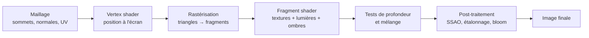

# Techniques de rendu

> Les notions de base, puis la configuration réellement utilisée par le projet (`Assets/Settings/PC_*_RPAsset.asset`, `PC_*_Renderer.asset`, `ProjectSettings/QualitySettings.asset`, `Assets/Resources/RenderQualitySettings.asset`).

## Du modèle 3D au pixel

- **Vertex (sommet)** : point d'un maillage, avec une position, une normale (orientation de la surface) et des coordonnées de texture (UV). Le *vertex shader* le projette à l'écran ; il sert aussi aux déformations (vent, skinning des personnages).
- **Fragment (pixel)** : le *fragment shader* calcule la couleur de chaque pixel couvert par un triangle à partir des textures, des lumières et des ombres. C'est en général la partie la plus coûteuse.
- **Shader** : programme exécuté par la carte graphique. Dans URP, les matériaux utilisent surtout le shader **Lit** (rendu physique, PBR) ; **Shader Graph** permet d'en créer visuellement.
- **Textures** : images appliquées via les UV — couleur (*albedo*), relief (*normal map*), métal/rugosité, occlusion. Les **mipmaps** (versions réduites) évitent le scintillement au loin ; la **compression** réduit la mémoire vidéo.
- **Lumières** : directionnelle (soleil), ponctuelles, spots. En temps réel (recalculées chaque image) ou **précalculées** (*lightmaps*, *light probes*) pour un coût quasi nul en jeu.
- **Ombres** : rendues via des *shadow maps* (la scène vue depuis la lumière, en profondeur). Les **cascades** découpent la distance pour garder des ombres nettes près de la caméra ; le **bias** évite les artefacts (acné d'ombre, décollement).
- **Reflection probes** : captures de l'environnement pour les reflets (billes brillantes, bois verni).
- **Post-traitement** : effets appliqués à l'image entière (occlusion ambiante, étalonnage des couleurs, flou…), réglés par des *Volumes* URP.

## Configuration du projet

### Pipeline

| Réglage | Valeur | Commentaire |
|---|---|---|
| Pipeline | URP 17.6 | Niveaux de qualité **Bas**, **Moyen** (par défaut sur PC), **Haut**, et **Mobile** ; un asset URP et un renderer par niveau PC (tableau complet : [Réglages > Qualité graphique](config.html#config:qualite-graphique)). Les valeurs ci-dessous sont celles de Moyen (`PC_RPAsset`) |
| Chemin de rendu | **Forward+** | Les lumières sont triées par tuiles d'écran : beaucoup de lumières ponctuelles possibles sans multiplier le coût par objet (utile pour les halos de poches et de billes à pouvoir) |
| HDR | Activé | Nécessaire pour des halos lumineux intenses et un bloom crédible |
| MSAA (anticrénelage) | Désactivé | Remplacé par l'anticrénelage post-process de la caméra : FXAA en Moyen, SMAA en Haut, aucun en Bas |
| Render scale | 1 | Pleine résolution (Bas : 0,8 + FSR) |
| Depth texture / Opaque texture | Activées | Requises par le SSAO et certains effets VFX (distorsion, particules douces) ; coût mémoire et copie supplémentaires |
| SRP Batcher | Activé | Réduit le coût CPU des appels de dessin pour les matériaux compatibles |
| Dynamic batching | Désactivé | Normal avec le SRP Batcher |
| GPU Resident Drawer | Désactivé | Option Unity 6 pour les scènes très chargées ; non nécessaire aujourd'hui |

### Lumières et ombres

| Réglage | Valeur |
|---|---|
| Lumière principale | Par pixel, ombres activées, shadow map **2048** (Bas 1024, Haut 4096) |
| Lumières additionnelles | Par pixel (Forward+ : sans limite par objet), ombres activées, atlas **1024** (Bas : sans ombres, Haut 2048) |
| Distance des ombres | **20 m, 2 cascades** (25 %) ; Bas 15 m / 1, Haut 25 m / 2 (20 %) |
| Ombres douces | Qualité moyenne (Bas basse, Haut haute) |
| Bias | profondeur 0,1 / normale 0,5 |
| Cookies de lumière | Activés |
| Reflection probes | Mélange et projection en boîte activés |

Jusqu'au 17/11 : 50 m et 4 cascades, bien plus que la taille d'une salle. Ramenées à 20 m et 2 cascades, les ombres restent aussi nettes sur la table (la première cascade couvre 5 m) pour deux passes d'ombre de moins par caméra.

### Effets du renderer

- **SSAO** (Screen Space Ambient Occlusion) : assombrit les recoins et contacts (billes sur le tapis, pieds de table). Moyen : demi-résolution, source *Depth* (normales reconstruites depuis la profondeur), flou moyen. La source *Depth Normals* (Haut) ajoute une passe qui redessine toute la scène pour écrire les normales, par caméra. Bas : coupé.
- **Decal** : contour brûlé du pouvoir Trou.

### Caméra des joueurs

`CameraQuality` (ajouté par `LocalFpsPlayerController.Awake` sur la caméra du prefab) applique `RenderQualitySettings` : post-process allumé et anticrénelage du niveau, au lancement puis à chaque `QualitySettings.activeQualityLevelChanged`. Le prefab `New` avait le post-process coupé : le Bloom des néons, l'étalonnage et le volume des ambiances (`AmbienceController`) ne se voyaient pas en jeu. Le profil de base est le *Volume Profile* de l'asset URP (`SampleSceneProfile` : tonemapping Neutral, Bloom, vignette).

### Ambiance par type de niveau

Deux axes indépendants : le **niveau de qualité** (Bas / Moyen / Haut) décide du coût, l'**ambiance** (`AmbiencePreset`) de l'aspect. Chaque `LevelEntry` de `GameFlowSettings` désigne l'ambiance de son type de niveau. `LevelAmbience` (statique, `RuntimeInitializeOnLoadMethod` + `SceneManager.sceneLoaded`) retrouve l'entrée par le nom de la scène. Si la scène a un `AmbienceController` (éclairage précalculé), l'ambiance devient son `active` avant son `Start` ; sinon il en crée un avec un `Volume` global et la lumière principale de la scène (`RenderSettings.sun`, sinon la directionnelle la plus forte). `AmbienceController.Apply` fait le reste : ciel, ambiante, lumière principale, profil du volume, brouillard, lampes du décor, scénario APV s'il a été précalculé. Sans précalcul, aucune scène n'est modifiée : l'ambiance ne vit qu'en Play mode.

**Particules d'ambiance** (`AmbienceParticles`, créé par `AmbienceController.Apply` en Play mode seulement) : deux systèmes de particules dans le monde, partagés par les deux caméras, à la taille du niveau (union des `MeshRenderer` de la scène hors joueurs, 80 m au plus de côté) : poussière dans tout le volume (additive, 0,35 grain par m³ à l'intensité 1, 3 000 au plus) et brume près du sol (alpha, grandes particules douces, *soft particles* et effacement près de la caméra, 0,06 par m², 300 au plus). Préchauffées (pleines dès le départ), elles ne sont reconstruites que si leurs réglages changent. Particules *Unlit* : elles ne réagissent pas aux lampes.

**Réglage en direct** : `AmbiencePreset.OnValidate` lève l'événement `Edited` ; en Play mode, l'`AmbienceController` réapplique l'ambiance en cours dès qu'on la modifie dans l'Inspector (brouillard, lumières, ciel, Volume, particules). Hors Play, rien n'est écrit dans la scène.

**Précalcul** (`LevelLightingTools`, *Tools > Pool > Précalculer l'éclairage du niveau ouvert*) : met l'ambiance du niveau dans l'`AmbienceController` de la scène (créé au besoin), ajoute une sonde de reflet à boîte autour du décor *Reflection Probe Static* s'il n'y en a aucune, puis lance `AmbienceTools.Bake` (le précalcul APV du Level Maker : lumières passées en *Mixed*, éclairage indirect seulement, un scénario par ambiance). À la fin (`AmbienceTools.BakeFinished`), chaque sonde de reflet est précalculée (`Lightmapping.BakeReflectionProbe`) dans un `.exr` du dossier de la scène et passe en mode *Custom* sur cette texture, pour ne dépendre d'aucun fichier de données d'éclairage.

### Écran partagé

Chaque joueur a sa propre caméra : **la scène est rendue deux fois par image**, chacune sur la moitié de l'écran. Tout coût par caméra (ombres, SSAO, post-process) est donc doublé. La hauteur de la vue de dessus est corrigée selon la forme du demi-écran (`PlacementHeightForCurrentViewport`).

## Éléments visuels propres au jeu

| Élément | Technique |
|---|---|
| **Numéros des billes** | Texture générée par l'éditeur (`PoolBallTextureGenerator`) : couleur pleine ou bande blanche + numéro, 256×128, sans mipmaps, écrite en PNG dans `Assets/Textures/Balls` |
| **Halo de poche** | Lumière ponctuelle dont l'intensité décroît sur la durée (`PoolPocket`), réutilisée pour la surbrillance de sélection |
| **Aura qui monte** | Système de particules Cartoon FX instancié à la poche |
| **Bille à pouvoir** | Lumière ponctuelle enfant + échange de matériau par catégorie (`sharedMaterial`, sans créer de copie) |
| **Poche fermée** | Prefab optionnel, sinon cylindre rouge généré au lancement |
| **Voiles d'écran** (vision brouillée, flashs) | Rectangle plein écran dessiné en `OnGUI` avec transparence |
| **Ligne de trajectoire** | `LineRenderer` |
| **Corps du joueur** | Maillage skinné (animations Mixamo) déformé par l'IK et, en chute, par PuppetMaster |

## Pistes

- Précalculer l'éclairage de la salle (**lightmaps**) et ne garder en temps réel que les lumières dynamiques (halos, effets).
- Remplacer les voiles `OnGUI` par un effet de post-process ou un canvas UI (meilleure intégration, pas de coût `OnGUI`).
